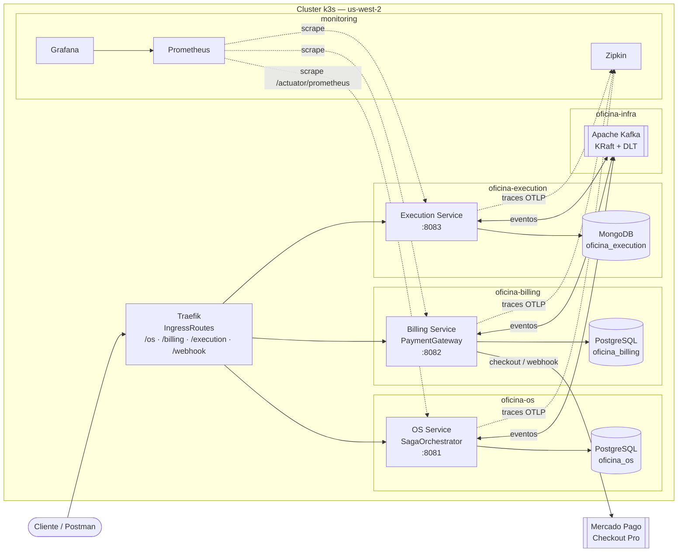
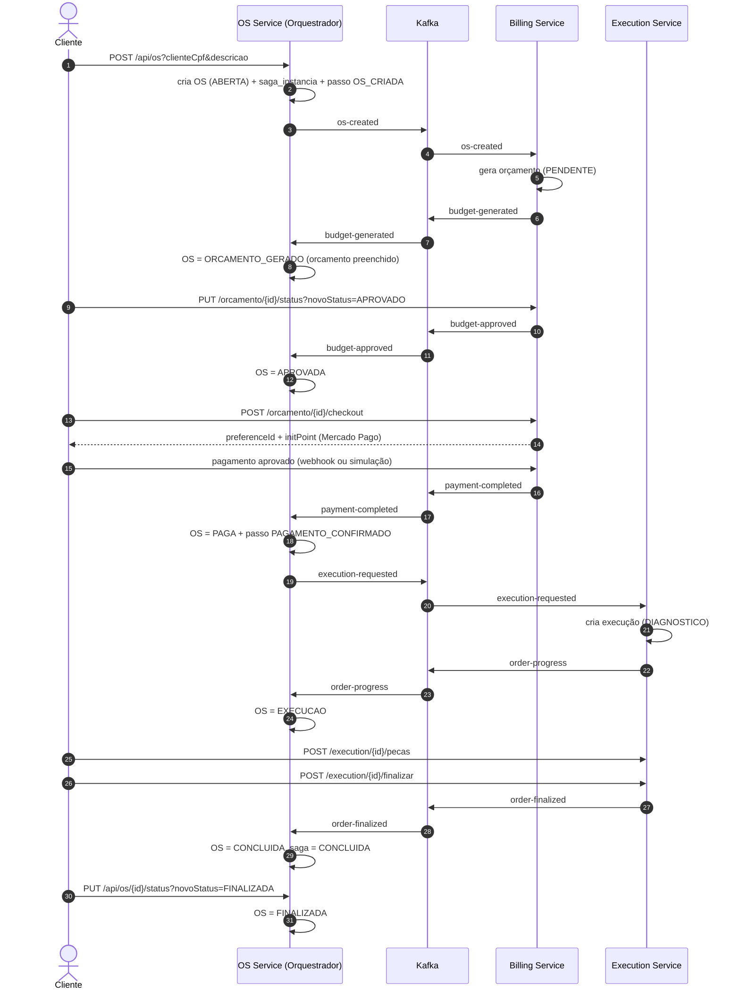
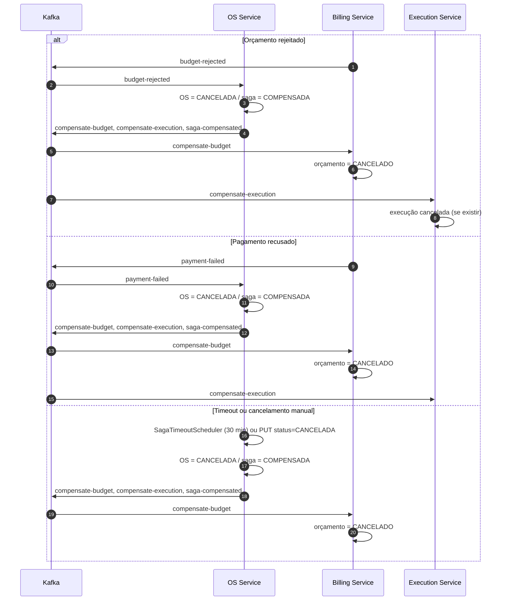
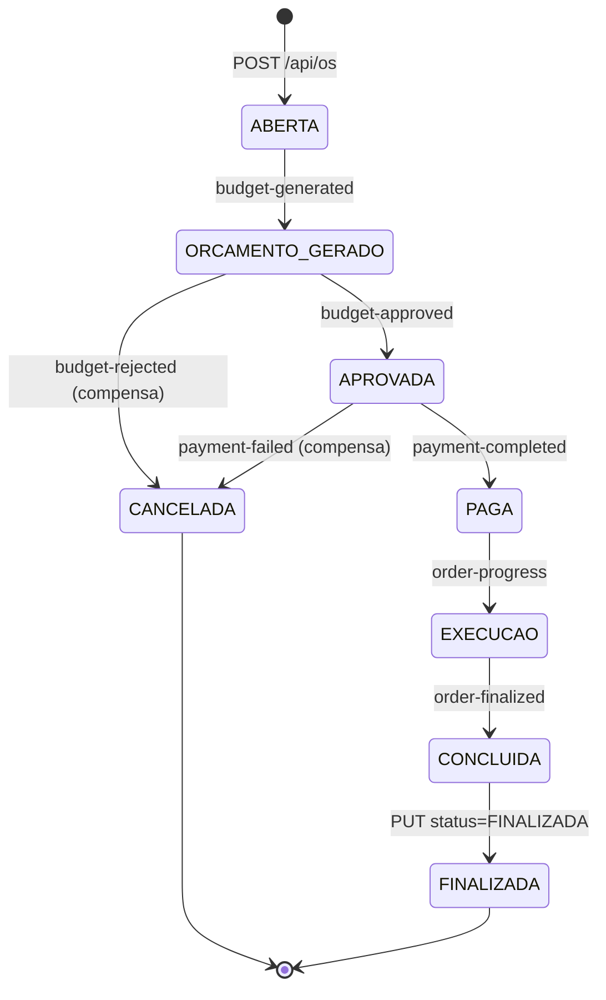
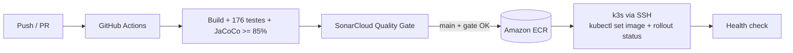

# Arquitetura — Tech Challenge Fase 4

Documento técnico da arquitetura de microsserviços da oficina mecânica, com foco na **Saga orquestrada**, nos **eventos Kafka**, na **observabilidade** e no **deploy na AWS**.

- **Autor:** Marcos da Paz Araujo
- **Stack:** Java 17, Spring Boot 3.2.x, PostgreSQL, MongoDB, Apache Kafka (KRaft), Kubernetes (k3s), GitHub Actions, Amazon ECR/RDS
- **Ambiente publicado:** `http://44.253.115.185`

---

## 1. Visão geral

A solução é dividida em três serviços independentes, cada um com repositório Git, banco de dados, pipeline e ciclo de deploy próprios. A integração é **assíncrona por eventos Kafka** e a consistência é mantida por uma **Saga orquestrada** centralizada no OS Service.

| Serviço | Responsabilidade | Banco | Porta | Namespace |
|---|---|---|---|---|
| **OS Service** | Ordem de serviço, máquina de estados, **orquestração da Saga**, histórico e idempotência | PostgreSQL `oficina_os` (RDS) | 8081 | `oficina-os` |
| **Billing Service** | Orçamento, aprovação, pagamento e compensação financeira | PostgreSQL `oficina_billing` (RDS) | 8082 | `oficina-billing` |
| **Execution Service** | Diagnóstico, peças, execução e entrega | MongoDB `oficina_execution` (StatefulSet) | 8083 | `oficina-execution` |



### 1.1 Camadas internas (iguais nos três serviços)

```
presentation (controllers, DTOs)
      |
application (services, saga, ports)
      |
domain (entidades e regras)
      ^
infrastructure (JPA/Mongo repositories, adapters)
      |
config (Kafka listeners, error handler, OpenAPI, observabilidade)
```

Regras aplicadas:

- Controllers **não** conhecem detalhes de persistência; conversam com a camada `application`.
- Integrações externas ficam atrás de **portas** (`PaymentGateway`), com o provider real `MercadoPagoPaymentGateway` ativo no cluster e uma implementação de `MockPaymentGateway` disponível para desenvolvimento local.
- Cada serviço tem seu próprio banco — **não há acesso cruzado a banco** entre serviços.

---

## 2. Saga orquestrada

### 2.1 Por que orquestrada

A orquestração concentra a máquina de estados em um único ponto (OS Service), o que simplifica a auditoria (`saga_instancia`, `saga_passo`, `ordem_servico_historico`) e a compensação. Os demais serviços são **participantes**: reagem a comandos/eventos e publicam o resultado.

### 2.2 Modelo de dados da Saga (OS Service)

| Tabela | Função |
|---|---|
| `saga_instancia` | Uma linha por saga (`saga_id`, `os_id`, `os_numero`, `status`, `passo_atual`, `motivo`) |
| `saga_passo` | Trilha de passos executados (`saga_id`, `passo`, `status`, `detalhe`, timestamp) |
| `ordem_servico_historico` | Transições de status da OS com `saga_id` e motivo |
| `evento_processado` | Idempotência: `event_id` + tópico já consumido |

Estados da saga: `EM_ANDAMENTO` → `CONCLUIDA` | `COMPENSADA`.

Passos registrados: `OS_CRIADA`, `ORCAMENTO_GERADO`, `ORCAMENTO_APROVADO`, `PAGAMENTO_CONFIRMADO`, `EXECUCAO_INICIADA`, `EXECUCAO_FINALIZADA`, `COMPENSACAO`.

### 2.3 Fluxo feliz



### 2.4 Compensações

A compensação é **idempotente por `sagaId`**: se a saga já está `COMPENSADA`, o orquestrador apenas devolve o estado atual. Ela é disparada por:

- `budget-rejected` — orçamento rejeitado pelo cliente;
- `payment-failed` — pagamento recusado;
- **timeout** — `SagaTimeoutScheduler` compensa sagas sem evolução há 30 minutos (verificação a cada 60s, configurável por `saga.timeout.minutes` / `saga.timeout.check-ms`);
- **cancelamento manual** — `PUT /api/os/{id}/status?novoStatus=CANCELADA`.

Ao compensar, o OS Service:

1. registra o histórico com o motivo;
2. muda a OS para `CANCELADA`;
3. marca a saga como `COMPENSADA` e grava o passo `COMPENSACAO`;
4. publica `compensate-budget`, `compensate-execution` e `saga-compensated`.



### 2.5 Máquina de estados da OS



> `CANCELADA` também pode ser alcançada por timeout de 30 minutos (`SagaTimeoutScheduler`) ou cancelamento manual.

### 2.6 Idempotência e tratamento de erro

- Cada evento carrega `eventId` (UUID) e `sagaId`. Os três serviços gravam `evento_processado(event_id, topico)` antes/durante o processamento; repetições são descartadas.
- O envelope é JSON (`SagaEvent`) com `eventId`, `type`, `sagaId`, `osId`, `osNumero`, `clienteCpf`, `valor`, `status`, `paymentId`, `codigoOrcamento`, `message`, `timestamp`.
- Erros de desserialização/negócio lançam exceção e vão para o **DefaultErrorHandler** com backoff; após esgotar as tentativas o evento é enviado ao tópico **`.DLT`** correspondente (`KafkaErrorHandlerConfig` em Billing e Execution; handler equivalente no OS).
- Tópicos consumidos têm `.DLT` dedicado (`execution-compensated.DLT` incluso). `saga-compensated` é apenas auditoria e não possui DLT.

---

## 3. Catálogo de eventos

| Tópico | Produtor | Consumidor | Papel |
|---|---|---|---|
| `os-created` | OS Service | Billing | Solicita geração de orçamento |
| `budget-generated` | Billing | OS Service | Orçamento criado, valor disponível |
| `budget-approved` | Billing | OS Service | Cliente aprovou o orçamento |
| `budget-rejected` | Billing | OS Service | Cliente rejeitou — dispara compensação |
| `payment-completed` | Billing | OS Service | Pagamento confirmado |
| `payment-failed` | Billing | OS Service | Pagamento recusado — dispara compensação |
| `execution-requested` | OS Service | Execution | Comando para iniciar execução |
| `order-progress` | Execution | OS Service | Execução iniciada/progredindo |
| `order-finalized` | Execution | OS Service | Execução finalizada |
| `compensate-budget` | OS Service | Billing | Comando de compensação do orçamento |
| `compensate-execution` | OS Service | Execution | Comando de compensação da execução |
| `saga-compensated` | OS Service | — (auditoria) | Fechamento da saga compensada |
| `execution-compensated` | Execution | OS Service | Confirmação da compensação da execução |

Grupos de consumo: `os-service-group`, `billing-service-group`, `execution-service-group`.

---

## 4. Porta de pagamento (`PaymentGateway`)

```java
public interface PaymentGateway {
    CheckoutResult criarCheckout(Orcamento orcamento);
    PaymentResult consultarPagamento(String paymentId);
    boolean validarAssinatura(String dataId, String signature, String requestId);
    boolean isMock();
}
```

| Provider | Configuração | Comportamento |
|---|---|---|
| `mercadopago` | `PAGAMENTO_PROVIDER=mercadopago` + `MERCADOPAGO_ACCESS_TOKEN` + `MERCADOPAGO_WEBHOOK_SECRET` | **Ativo no cluster**: cria a preferência no Checkout Pro, consulta o pagamento em `/v1/payments/{id}` e valida a assinatura HMAC-SHA256 do webhook |
| `mock` | `PAGAMENTO_PROVIDER=mock` | Implementação de desenvolvimento local: preferência fictícia e simulação de aprovação/recusa |
| — | `MERCADOPAGO_BACK_URL` | URL de retorno do checkout; `auto_return` só é enviado quando ela usa `https://` |

A porta isola os casos de uso: trocar o provedor **não** exige alterar `BillingApplicationServiceImpl` nem a Saga — apenas `PAGAMENTO_PROVIDER` e as credenciais no secret do cluster.

O webhook ignora notificações de tipo diferente de `payment` e só muda o orçamento em estados finais (`approved`, `rejected`, `cancelled`, `refunded`, `charged_back`); `pending`/`in_process` respondem `200 pendente` sem publicar evento.

---

## 5. Observabilidade

| Pilar | Ferramenta | Endereço | Evidência |
|---|---|---|---|
| Métricas | Prometheus | `/prometheus/` | targets `os-service`, `billing-service`, `execution-service` = `up` |
| Dashboards | Grafana | `/grafana/` (admin/admin) | dashboard **Oficina Fase 4 - Microsservicos** |
| Traces | Zipkin | `/zipkin/` | traces dos 3 `spring.application.name` |
| Saúde | Actuator | `/{servico}/actuator/health` | readiness/liveness |

- Os serviços expõem `/actuator/prometheus` (Micrometer) e enviam traces via **Micrometer Tracing + OpenTelemetry/Zipkin**.
- O `sagaId` é propagado no MDC e aparece nos logs e nos traces, permitindo seguir uma OS ponta a ponta.
- Painéis do dashboard: requisições/s por serviço, p95 de latência, erros 5xx, heap JVM — todos agrupados pelo label `job`.

---

## 6. Deploy e CI/CD



- `main` protegida: PR obrigatório + check **Build, testes, cobertura e SonarCloud**.
- Push em `main` gera imagem com a tag do commit, publica no ECR e faz `kubectl set image` + `rollout status` no namespace do serviço.
- Cada serviço roda com **2 réplicas**, probes de readiness/liveness e limits de memória.

### 6.1 Infraestrutura provisionada

| Recurso | Detalhe |
|---|---|
| Cluster | k3s — 1 server + 2 workers `t3.small`, VPC `10.0.0.0/16` |
| EIP | `44.253.115.185` |
| RDS | `tc-oficina-os-db` e `tc-oficina-billing-db`, PostgreSQL, subnets privadas |
| MongoDB | StatefulSet `execution-mongo` (namespace `oficina-execution`) |
| Kafka | KRaft `kafka-0` (namespace `oficina-infra`) + Jobs de criação de tópicos/DLT |
| Monitoring | namespace `monitoring` — Prometheus, Grafana, Zipkin + IngressRoutes |
| ECR | `200111905660.dkr.ecr.us-west-2.amazonaws.com/tc-oficina-*-service` |

---

## 7. Segurança

- Nenhum segredo é commitado nos repositórios dos serviços: `k8s/secret.yaml` é ignorado pelo Git e criado via `kubectl create secret`/`stringData` fora do versionamento.
- No pipeline, credenciais são passadas por `env:` (nunca interpoladas diretamente em `run:`), evitando exposição em logs (regra Sonar S7636).
- O webhook não registra o corpo da requisição (apenas o tamanho), prevenindo *log injection* (S5145).
- Comunicação externa apenas via Traefik; os bancos ficam em subnets privadas e o MongoDB não é exposto fora do cluster.

---

## 8. Decisões e trade-offs

| Decisão | Motivo | Trade-off |
|---|---|---|
| Saga **orquestrada** no OS Service | Estado central, auditoria simples, compensação determinística | OS Service é ponto central de lógica (mas não de disponibilidade: retries + DLT) |
| **Coreografia** entre Billing/Execution e OS | Baixo acoplamento, cada serviço evolui sozinho | Exige contrato de eventos estável |
| **Outbox não implementado** | Escopo/tempo do desafio | Janela pequena de perda de evento se o broker cair entre commit e publish; mitigada por idempotência e DLT |
| Pagamento via **porta** | Isola o provedor e permite evoluir a integração sem tocar nos casos de uso | Exige credenciais e configuração por ambiente |
| **2 réplicas** por serviço | Demonstra resiliência e rolling update | Consumo de memória no cluster de 2 GB por nó |

---

## 9. Limitações conhecidas

1. O provider real `MercadoPagoPaymentGateway` está **ativo** no cluster (`PAGAMENTO_PROVIDER=mercadopago`), com credenciais de sandbox no secret `billing-service-secret`. A porta mantém uma implementação de desenvolvimento local para execução fora do cluster.
2. Sem Transactional Outbox — a publicação ocorre dentro da transação, sem tabela de outbox dedicada.
3. Testes de integração com Testcontainers não fazem parte do escopo desta fase.
4. O cluster é de laboratório (AWS Academy), com memória apertada; deploys são feitos um serviço por vez.
