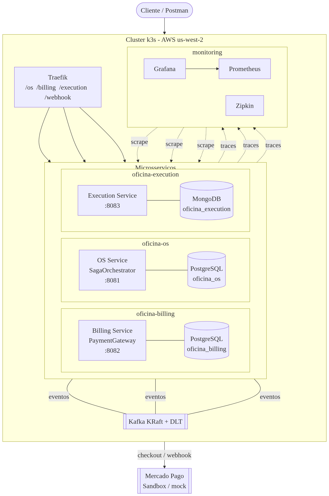
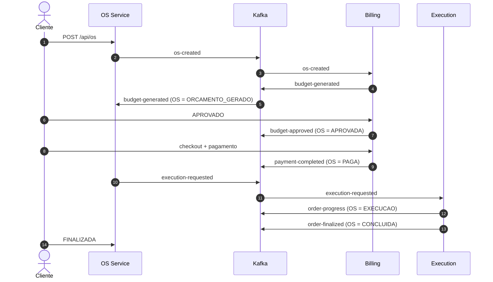

# Tech Challenge Fase 4 — Oficina Mecânica

Sistema da oficina mecânica implementado como **três microsserviços independentes**, integrados por **Apache Kafka** com **Saga orquestrada**, deploy automatizado na AWS e observabilidade completa.

Cada serviço é um **repositório Git próprio**, com banco, Dockerfile, manifestos Kubernetes e pipeline de CI/CD independentes. Este repositório concentra apenas a **documentação da entrega**.

- **Participante:** Marcos da Paz Araujo
- **Ambiente publicado:** `http://44.253.115.185`
- **Relatório:** [RELATORIO.md](RELATORIO.md) ([PDF](RELATORIO.pdf))
- **Arquitetura e diagramas:** [ARQUITETURA.md](ARQUITETURA.md)
- **Postman:** [postman/](postman/)
- **Evidências:** [evidencias/](evidencias/)

## Repositórios

| Serviço | Repositório | Porta | Banco | Namespace |
|---|---|---|---|---|
| Ordem de Serviço — **orquestrador da Saga** | https://github.com/rtmaraujo/tc-oficina-os-service | 8081 | PostgreSQL `oficina_os` (RDS) | `oficina-os` |
| Orçamento e Pagamento | https://github.com/rtmaraujo/tc-oficina-billing-service | 8082 | PostgreSQL `oficina_billing` (RDS) | `oficina-billing` |
| Execução e Diagnóstico | https://github.com/rtmaraujo/tc-oficina-execution-service | 8083 | MongoDB `oficina_execution` (StatefulSet) | `oficina-execution` |

## Stack

- **Linguagem:** Java 17
- **Framework:** Spring Boot 3.2.2 (Web, Data JPA, Data MongoDB, Kafka, Actuator)
- **Mensageria:** Apache Kafka (KRaft) com tópicos `.DLT`
- **Bancos:** PostgreSQL 15 (OS e Billing) e MongoDB 7 (Execution)
- **Testes:** JUnit 5, Mockito, Cucumber (BDD)
- **Cobertura:** JaCoCo — mínimo de **85%** (LINE e BRANCH)
- **Observabilidade:** Micrometer, Prometheus, Grafana e Zipkin (OpenTelemetry)
- **Containers:** Docker multi-stage (build Maven + runtime JRE Alpine)
- **Orquestração:** Kubernetes (k3s) + Traefik
- **CI/CD:** GitHub Actions + Amazon ECR + deploy via SSH no k3s
- **Qualidade:** SonarCloud (organização `rtmaraujo`)

## Arquitetura



Detalhes, diagramas Mermaid (Saga, sequência, máquina de estados) e decisões: [ARQUITETURA.md](ARQUITETURA.md).

Cada serviço segue o mesmo desenho em camadas:

```
presentation -> application -> domain <- infrastructure
                                  |
                                config (listeners Kafka, error handler)
```

### Infraestrutura

- **Cluster:** k3s em EC2 — `us-west-2`, VPC `10.0.0.0/16`, 1 server + 2 workers `t3.small`, EIP `44.253.115.185`, Traefik.
- **Mensageria:** Kafka KRaft no namespace `oficina-infra` (tópicos e DLT criados por Job).
- **Bancos:** RDS PostgreSQL `tc-oficina-os-db` e `tc-oficina-billing-db` (subnets privadas) + MongoDB StatefulSet `execution-mongo`.
- **Imagens:** Amazon ECR `200111905660.dkr.ecr.us-west-2.amazonaws.com/tc-oficina-*-service`.
- **Observabilidade:** namespace `monitoring` (Prometheus, Grafana, Zipkin).
- **`main` protegida:** PR obrigatório + check `Build, testes, cobertura e SonarCloud`.

## Saga orquestrada

O **OS Service** mantém a máquina de estados, registra cada passo e decide os próximos comandos. Billing e Execution são participantes e publicam o resultado.



**Compensação** (orçamento rejeitado, pagamento recusado, timeout de 30 min ou cancelamento manual):

```
OS = CANCELADA · saga = COMPENSADA · orçamento = CANCELADO
publica: compensate-budget, compensate-execution, saga-compensated
```

**Idempotência:** `evento_processado(event_id, topico)` nos três serviços. **DLQ:** cada tópico tem `.DLT` via `DefaultErrorHandler` com backoff.

Trilha de auditoria no OS Service: `saga_instancia`, `saga_passo`, `ordem_servico_historico`.

## API — resumo dos endpoints

### OS Service — `http://44.253.115.185/os`

| Método | Rota | Descrição |
|---|---|---|
| `POST` | `/api/os?clienteCpf=&descricao=` | Cria OS (`ABERTA`) e inicia a saga |
| `GET` | `/api/os/{id}` | Consulta OS |
| `GET` | `/api/os/cliente/{clienteCpf}` | Lista por cliente |
| `GET` | `/api/os/{id}/historico` | Histórico com `sagaId` e motivo |
| `PUT` | `/api/os/{id}/status?novoStatus=` | Atualiza status (ex.: `FINALIZADA`) |

### Billing Service — `http://44.253.115.185/billing`

| Método | Rota | Descrição |
|---|---|---|
| `POST` | `/api/billing/orcamento?clienteCpf=&valor=` | Gera orçamento manual |
| `GET` | `/api/billing/orcamento/{id}` | Consulta orçamento |
| `GET` | `/api/billing/cliente/{clienteCpf}` | Lista por cliente |
| `PUT` | `/api/billing/orcamento/{id}/status?novoStatus=` | Aprova/rejeita |
| `POST` | `/api/billing/orcamento/{id}/checkout` | Cria a preferência no Mercado Pago |
| `POST` | `/webhook/mercadopago` | Webhook assinado do Mercado Pago |

### Execution Service — `http://44.253.115.185/execution`

| Método | Rota | Descrição |
|---|---|---|
| `POST` | `/api/execution/iniciar/{osNumero}` | Inicia diagnóstico |
| `PUT` | `/api/execution/{id}/status?statusExecucao=` | Atualiza status |
| `POST` | `/api/execution/{id}/pecas?pecas=` | Registra peças |
| `POST` | `/api/execution/{id}/finalizar` | Finaliza execução |
| `GET` | `/api/execution/{id}` | Consulta execução |
| `GET` | `/api/execution/status/{statusExecucao}` | Lista por status |

Swagger UI: `/os/swagger-ui/index.html`, `/billing/swagger-ui/index.html`, `/execution/swagger-ui/index.html`.

## Eventos Kafka

| Tópico | Produtor | Consumidor | Papel |
|---|---|---|---|
| `os-created` | OS | Billing | Solicita orçamento |
| `budget-generated` | Billing | OS | Orçamento criado |
| `budget-approved` | Billing | OS | Orçamento aprovado |
| `budget-rejected` | Billing | OS | Rejeição → compensação |
| `payment-completed` | Billing | OS | Pagamento confirmado |
| `payment-failed` | Billing | OS | Pagamento recusado → compensação |
| `execution-requested` | OS | Execution | Inicia execução |
| `order-progress` | Execution | OS | Progresso da execução |
| `order-finalized` | Execution | OS | Execução finalizada |
| `compensate-budget` | OS | Billing | Compensa orçamento |
| `compensate-execution` | OS | Execution | Compensa execução |
| `saga-compensated` | OS | — | Auditoria |
| `execution-compensated` | Execution | OS | Confirmação da compensação |

Todos os tópicos consumidos têm `.DLT` correspondente. Grupos: `os-service-group`, `billing-service-group`, `execution-service-group`.

## Pagamento — Mercado Pago (Checkout Pro)

O pagamento fica atrás da porta `PaymentGateway`, selecionada por `PAGAMENTO_PROVIDER`. No cluster o provider ativo é o **Mercado Pago**:

- Cria a preferência no **Checkout Pro** (`POST /checkout/preferences`) e devolve `preferenceId` + `initPoint`.
- Consulta o pagamento (`GET /v1/payments/{id}`) antes de concluir.
- Valida a assinatura **HMAC-SHA256** do webhook `/webhook/mercadopago`.

O webhook ignora tipos diferentes de `payment`, valida a assinatura e só processa estados finais (`approved`, `rejected`, `cancelled`, `refunded`, `charged_back`); `pending`/`in_process` respondem `200 pendente` sem publicar evento, para não compensar uma OS que ainda pode ser paga.

> `auto_return` só é enviado quando a back URL é `https` — o Mercado Pago rejeita `auto_return` com `back_urls` http.

A mesma porta permite um provider de desenvolvimento local, usado apenas fora do cluster; a troca não exige alterar os casos de uso nem a Saga.

## Testes e cobertura

```bash
mvn test      # testes unitários
mvn verify    # testes + jacoco:check (falha abaixo de 85% LINE e BRANCH)
```

| Serviço | Testes | Falhas | Linhas | Branches |
|---|---|---|---|---|
| OS | 66 | 0 | **100,00%** | **96,36%** |
| Billing | 90 | 0 | **99,07%** | **91,67%** |
| Execution | 44 | 0 | **98,63%** | **90,38%** |
| **Total** | **200** | **0** | — | — |

- Relatório HTML: `target/site/jacoco/index.html` em cada serviço.
- **BDD (Cucumber):** fluxo da Saga no OS Service (`src/test/resources/features/ordem-servico-saga.feature`).

## Observabilidade

| Pilar | Ferramenta | URL |
|---|---|---|
| Métricas | Prometheus | `http://44.253.115.185/prometheus/` |
| Dashboards | Grafana | `http://44.253.115.185/grafana/` (admin/admin) |
| Traces | Zipkin | `http://44.253.115.185/zipkin/` |
| Saúde | Actuator | `http://44.253.115.185/{os,billing,execution}/actuator/health` |

Dashboard provisionado: **Oficina Fase 4 - Microsservicos** (requisições/s, p95, erros 5xx e heap JVM por `job`). O `sagaId` é propagado no MDC e aparece nos logs dos três serviços.

## Qualidade (SonarCloud)

- https://sonarcloud.io/project/overview?id=rtmaraujo_tc-oficina-os-service
- https://sonarcloud.io/project/overview?id=rtmaraujo_tc-oficina-billing-service
- https://sonarcloud.io/project/overview?id=rtmaraujo_tc-oficina-execution-service

## Evidências

- [Evidência SQL da Saga](evidencias/saga-evidence-2026-11-03.txt): 10 sagas, 44 passos e eventos dos 7 tópicos consumidos.
- Fluxo feliz, compensação por orçamento rejeitado e compensação por pagamento recusado detalhados no [relatório](RELATORIO.md#10-evidências-dos-fluxos-executados).

## Como executar

Cada serviço tem instruções próprias no respectivo README:

- https://github.com/rtmaraujo/tc-oficina-os-service#como-executar-localmente
- https://github.com/rtmaraujo/tc-oficina-billing-service#como-executar-localmente
- https://github.com/rtmaraujo/tc-oficina-execution-service#como-executar-localmente

Para o ambiente completo, os manifestos de Kafka, monitoramento e correções de schema estão versionados nos repositórios de infraestrutura locais da entrega.

> Deploys devem ser feitos **um serviço por vez** — o cluster de laboratório tem 2 GB por nó e `kubectl apply` simultâneo pode estourar memória.

## CI/CD

Cada serviço possui `.github/workflows/ci.yml`:

1. Checkout + JDK 17 + cache Maven.
2. `mvn verify` — testes + `jacoco:check` (>= 85%).
3. SonarCloud com `-Dsonar.qualitygate.wait=true`.
4. Em push na `main`: build/push da imagem (tag do commit) no ECR e deploy no k3s (`kubectl set image` + `rollout status`).

A `main` exige PR e o check **Build, testes, cobertura e SonarCloud**. Entregas: PR **#7** no OS, **#7** no Billing e **#6** no Execution.

## Segurança

- `k8s/secret.yaml` não é versionado; segredos são criados via `kubectl create secret`.
- No pipeline, credenciais passam por `env:` (nunca interpoladas em `run:`), evitando exposição em logs (Sonar S7636).
- O webhook não registra o corpo da requisição (apenas o tamanho), prevenindo *log injection* (S5145).
- Bancos em subnets privadas; MongoDB não exposto fora do cluster.

## Estrutura deste repositório

```
tc-oficina-docs/
├── README.md
├── RELATORIO.md
├── RELATORIO.pdf
├── ARQUITETURA.md
├── build-pdf.py
├── diagrams/
│   ├── diagrama-arquitetura.mmd
│   └── diagrama-arquitetura.png
├── evidencias/
│   └── saga-evidence-2026-11-03.txt
└── postman/
    ├── Tech-Challenge-Fase4.postman_collection.json
    └── Tech-Challenge-Fase4.postman_environment.json
```

## Próximos passos

- [ ] Transactional Outbox
- [ ] Testes de integração com Testcontainers
