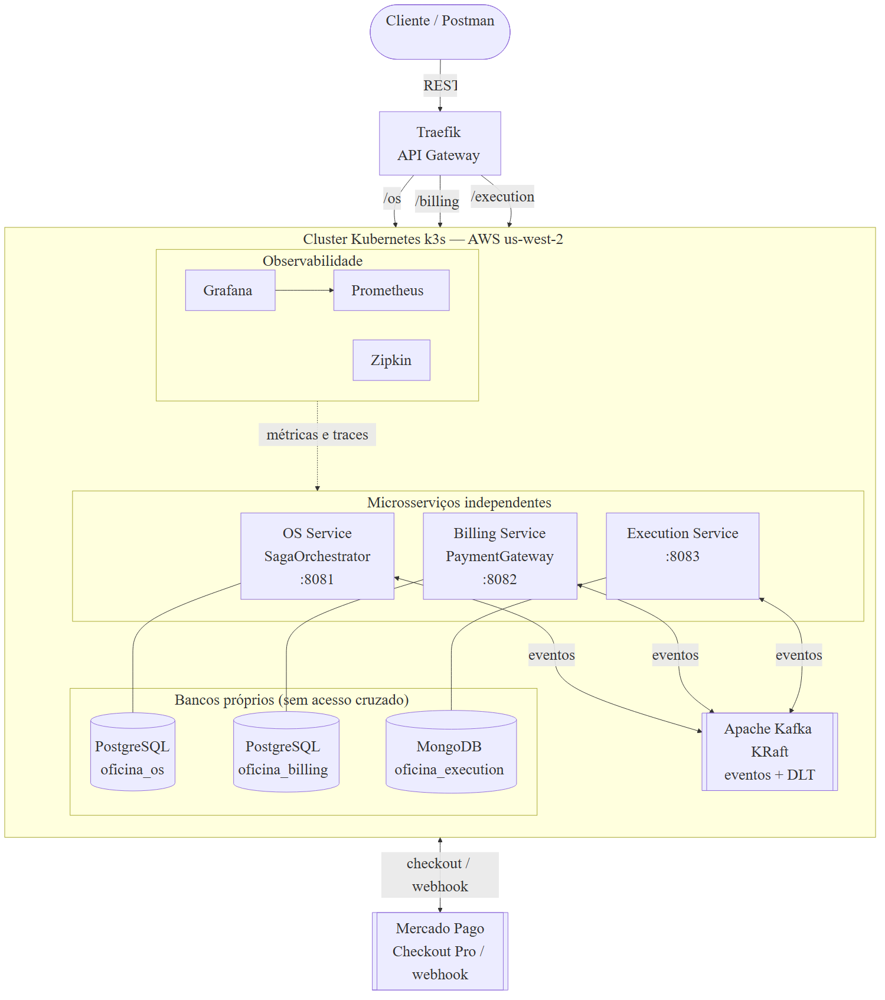

# Relatório de Entrega — Tech Challenge Fase 4

## 1. Links da entrega

| Item | Link |
|---|---|
| Repositório — OS Service | <https://github.com/rtmaraujo/tc-oficina-os-service> |
| Repositório — Billing Service | <https://github.com/rtmaraujo/tc-oficina-billing-service> |
| Repositório — Execution Service | <https://github.com/rtmaraujo/tc-oficina-execution-service> |
| Documentação e relatório | <https://github.com/rtmaraujo/tc-oficina-docs> |
| Infraestrutura Kubernetes/Terraform | <https://github.com/rtmaraujo/tc-oficina-infra-k8s> |
| Infraestrutura de banco (RDS) | <https://github.com/rtmaraujo/tc-oficina-infra-db> |
| Autenticação (Lambda/API Gateway) | <https://github.com/rtmaraujo/tc-oficina-lambda> |
| SonarCloud — OS | <https://sonarcloud.io/project/overview?id=rtmaraujo_tc-oficina-os-service> |
| SonarCloud — Billing | <https://sonarcloud.io/project/overview?id=rtmaraujo_tc-oficina-billing-service> |
| SonarCloud — Execution | <https://sonarcloud.io/project/overview?id=rtmaraujo_tc-oficina-execution-service> |
| Vídeo de demonstração | <https://youtu.be/Cp_my8VnOtY> |
| Ambiente publicado | <http://44.253.115.185> |

Todos os repositórios são **públicos**. O ambiente é um laboratório **AWS Academy** com credenciais temporárias; quando o laboratório está desligado, as evidências permanecem no vídeo e no arquivo [`evidencias/saga-evidence-2026-11-03.txt`](evidencias/saga-evidence-2026-11-03.txt).

<div class="page-break"></div>

## 2. Arquitetura geral



Legenda do diagrama:

- **Fluxo síncrono (REST):** Cliente → Traefik → serviços, para comandos e consultas que exigem resposta imediata.
- **Fluxo assíncrono (Kafka):** os três serviços trocam eventos e comandos por tópicos com `.DLT`.
- **Bancos isolados:** cada serviço acessa apenas o próprio banco; não há acesso cruzado.
- **Pagamento:** o Billing integra com o Mercado Pago (Checkout Pro + webhook).
- **Observabilidade:** Prometheus coleta métricas, Grafana exibe dashboards e Zipkin recebe traces dos três serviços.

### 2.1 Serviços

| Serviço | Responsabilidade | Banco | Porta | Namespace |
|---|---|---|---|---|
| **OS Service** | Ordem de serviço, máquina de estados, **orquestração da Saga**, histórico e idempotência | PostgreSQL `oficina_os` (RDS) | 8081 | `oficina-os` |
| **Billing Service** | Orçamento, aprovação, pagamento (porta `PaymentGateway`) e compensação | PostgreSQL `oficina_billing` (RDS) | 8082 | `oficina-billing` |
| **Execution Service** | Diagnóstico, peças, execução e entrega | MongoDB `oficina_execution` (StatefulSet) | 8083 | `oficina-execution` |

### 2.2 Camadas internas

Cada serviço segue o mesmo desenho em camadas:

```
presentation (controllers, DTOs)
      |
application (services, saga, ports)
      |
domain (entidades e regras)
      ^
infrastructure (JPA/Mongo repositories, adapters)
      |
config (Kafka listeners, error handler, OpenAPI, observabilidade)
```

Controllers não conhecem detalhes de persistência; integrações externas ficam atrás de portas (`PaymentGateway`). Cada serviço tem seu próprio banco, Dockerfile, manifestos Kubernetes e pipeline.

---

## 3. Conformidade com o enunciado

| Requisito | Como foi atendido | Onde ver |
|---|---|---|
| Identificação dos participantes | Grupo, nome, RM e Discord na capa | Página 1 |
| Pelo menos 3 microsserviços independentes | OS, Billing e Execution com repositórios, bancos e pipelines próprios | Seções 2, 5 e 13 |
| Banco relacional (SQL) | PostgreSQL 15 (RDS) para OS e Billing, em bases separadas | Seções 2.1 e 5.2 |
| Banco não relacional (NoSQL) | MongoDB 7 para o Execution | Seções 2.1 e 5.2 |
| Comunicação REST síncrona | APIs REST documentadas com OpenAPI/Swagger | Seção 8 |
| Mensageria assíncrona | Apache Kafka KRaft com tópicos `.DLT` | Seções 5.3 e 8.3 |
| Sem acesso direto ao banco de outro serviço | Cada serviço usa apenas o próprio banco; integração por API/evento | Seções 2 e 5.2 |
| Saga Pattern com rollback/compensação | Saga **orquestrada** no OS Service, com compensações idempotentes | Seção 7 |
| Testes unitários em todos os serviços | JUnit 5 + Mockito nos três serviços | Seção 9.1 |
| Fluxo completo com BDD | Cucumber no OS Service, com cenário feliz e de compensação | Seção 9.1 |
| Cobertura mínima de 80% por serviço | JaCoCo ≥ 85% de linha e branch; todos acima de 90% | Seção 9.2 |
| SonarQube ou similar no CI | SonarCloud com Quality Gate obrigatório | Seção 9.3 |
| Pipeline CI/CD independente | GitHub Actions em cada repositório | Seção 10 |
| Deploy automatizado em Kubernetes | k3s + `kubectl set image` + `rollout status` | Seção 10 |
| Branch `main` protegida | PR obrigatório + check de build/testes/cobertura/Sonar | Seção 10 |
| Dockerfile e manifestos Kubernetes | Em cada repositório de domínio, pasta `k8s/` | Seção 13 |
| Observabilidade | Prometheus, Grafana e Zipkin | Seção 11 |
| Swagger ou Postman atualizado | Swagger UI + coleção Postman versionada | Seção 8.2 |
| Vídeo de demonstração | YouTube, até 15 minutos | Seção 1 |

---

## 4. Resumo executivo

A Fase 4 evoluiu o sistema monolítico das fases anteriores para **três microsserviços independentes**, cada um com repositório, banco, pipeline e ciclo de deploy próprios, integrados de forma **assíncrona por Apache Kafka**.

O núcleo da solução é uma **Saga orquestrada** no OS Service, que mantém a máquina de estados da ordem de serviço, registra cada passo (`saga_instancia` / `saga_passo`), garante **idempotência** por `eventId` e executa **compensações** quando o orçamento é rejeitado, o pagamento é recusado ou a execução falha.

Entregas concluídas:

- 3 serviços publicados no k3s com **2 réplicas cada**, imagens versionadas no Amazon ECR.
- Saga validada ponta a ponta: **fluxo feliz + 2 cenários de compensação**.
- **200 testes automatizados** (66 + 90 + 44), todos verdes, com JaCoCo acima do mínimo de 85%.
- **SonarCloud** com Quality Gate aprovado nos três projetos.
- **Prometheus + Grafana + Zipkin** funcionando, com dashboard provisionado e traces dos três serviços.
- Pipelines GitHub Actions com build, testes, cobertura, análise e deploy — `main` protegida por PR.

---

## 5. Justificativa da divisão e das tecnologias

### 5.1 Por que três microsserviços

A divisão segue os **contextos delimitados** do negócio da oficina:

| Serviço | Contexto | Motivo da separação | Banco |
|---|---|---|---|
| **OS Service** | Ciclo de vida da ordem de serviço | Concentra a máquina de estados e a orquestração da Saga; precisa de consistência forte e auditoria de cada transição | PostgreSQL |
| **Billing Service** | Orçamento, aprovação e pagamento | Isola a integração com o Mercado Pago e os dados financeiros; pode escalar e evoluir o provider de pagamento sem afetar a OS | PostgreSQL |
| **Execution Service** | Diagnóstico, peças e execução | Operações longas e dados semiestruturados (etapas, peças, laudos); escalabilidade e modelo de dados diferentes do fluxo financeiro | MongoDB |

Benefícios obtidos:

- **Deploy independente:** cada serviço tem pipeline, imagem e rollout próprios.
- **Isolamento de falhas:** uma indisponibilidade no Execution não impede abertura, orçamento ou pagamento de uma OS.
- **Escalabilidade seletiva:** a fila de execução pode crescer sem replicar o Billing.
- **Autonomia de evolução:** o Billing troca mock por Mercado Pago apenas mudando configuração/porta, sem alterar a Saga.

O custo é a complexidade distribuída: consistência eventual, necessidade de Saga, idempotência, DLQ e observabilidade. Esses pontos são tratados nas seções 7 e 11.

### 5.2 Por que SQL e NoSQL

- **PostgreSQL 15 (SQL):** usado no OS e no Billing por exigir transações ACID, constraints de status, histórico e registros financeiros. São **duas bases separadas** (`oficina_os` e `oficina_billing`), cada uma acessível apenas pelo seu serviço.
- **MongoDB 7 (NoSQL):** usado no Execution porque os documentos de diagnóstico/execução têm formato variável (peças, etapas, observações) e evoluem com frequência.

Não existe acesso cruzado a banco: a integração ocorre exclusivamente por **REST** ou **eventos Kafka**.

### 5.3 Por que REST e Kafka

| Estilo | Uso | Exemplos |
|---|---|---|
| **REST síncrono** | Comandos e consultas que precisam de resposta imediata | abrir OS, consultar status, aprovar orçamento, criar checkout |
| **Kafka assíncrono** | Fluxos longos, eventos de domínio e desacoplamento | `os-created`, `budget-generated`, `payment-completed`, `execution-requested`, `order-finalized`, compensações |

A combinação evita acoplamento temporal nos processos longos (orçamento, pagamento e execução) sem abrir mão da simplicidade de REST para operações pontuais. A confiabilidade é reforçada por **idempotência** (`evento_processado`) e **DLT** por tópico.

---

## 6. Quadro resumo técnico

| Item | Escolha adotada |
|---|---|
| Linguagem | Java 17 |
| Framework | Spring Boot 3.2.2 (Web, Data JPA, Data MongoDB, Kafka, Actuator) |
| Microsserviços | 3: OS Service, Billing Service e Execution Service |
| Banco SQL | PostgreSQL 15 no Amazon RDS — bases `oficina_os` e `oficina_billing` |
| Banco NoSQL | MongoDB 7 — base `oficina_execution` (StatefulSet) |
| Comunicação síncrona | REST + OpenAPI/Swagger |
| Mensageria | Apache Kafka (KRaft) com tópicos `.DLT` |
| Saga Pattern | **Orquestrada** no OS Service (`saga_instancia` / `saga_passo`) |
| Pagamento | Mercado Pago Checkout Pro + webhook com HMAC-SHA256; mock para execução local |
| Testes | JUnit 5 + Mockito; BDD com Cucumber no OS Service |
| Cobertura | JaCoCo ≥ 85% (linha e branch); 200 testes; todos os serviços acima de 90% |
| Qualidade | SonarCloud com Quality Gate aprovado (equivalente ao SonarQube) |
| Infraestrutura | Terraform (ECR/RDS) + Kubernetes k3s em EC2 (VPC/EIP no console) + Traefik |
| CI/CD | GitHub Actions → Amazon ECR → `kubectl` no k3s; `main` protegida por PR |
| Observabilidade | Micrometer, Prometheus, Grafana e Zipkin (OpenTelemetry); `sagaId` no MDC |
| Segurança | Segredos fora do repositório, validação HMAC no webhook e relatório de vulnerabilidades |

> **Nota sobre Kubernetes:** o cluster é **k3s autogerenciado em EC2**, não EKS. O k3s é uma distribuição Kubernetes e atende ao requisito de deploy em Kubernetes do enunciado.

---

## 7. Saga Pattern

### 7.1 Estratégia escolhida: orquestração

Adotamos a **Saga orquestrada**. O **OS Service** é o orquestrador central: ele mantém a máquina de estados da ordem de serviço, decide o próximo passo e publica comandos. O Billing e o Execution são **participantes**: reagem aos comandos/eventos e publicam o resultado. Cada execução é identificada por um `sagaId` (`SAGA-<numeroOS>`), propagado no MDC, nos logs e nos traces.

A escolha pela orquestração — em vez da coreografia — foi feita porque o fluxo da OS tem uma ordem bem definida e precisa de auditoria e compensação determinísticas. Com um ponto central, é possível saber exatamente em qual passo a saga está (`saga_instancia.passo_atual`) e qual compensação executar. A coreografia exigiria que cada serviço conhecesse o fluxo global, dificultando a auditoria e o diagnóstico de falhas.

> **Pontos de falha compensados:** orçamento rejeitado, pagamento recusado, falha/timeout na execução e cancelamento manual. Não existe serviço de estoque neste domínio; por isso, a compensação cobre os recursos efetivamente transacionados: **orçamento, pagamento e execução**.

### 7.2 Modelo de dados da Saga (OS Service)

| Tabela | Conteúdo |
|---|---|
| `saga_instancia` | `saga_id`, `os_id`, `os_numero`, `status` (`EM_ANDAMENTO`/`CONCLUIDA`/`COMPENSADA`), `passo_atual`, `motivo` |
| `saga_passo` | Trilha de passos com status e detalhe |
| `ordem_servico_historico` | Transições de status com `saga_id` e motivo |
| `evento_processado` | Idempotência (`event_id` + tópico) |

Estados da saga: `EM_ANDAMENTO` → `CONCLUIDA` | `COMPENSADA`.

Passos registrados: `OS_CRIADA`, `ORCAMENTO_GERADO`, `ORCAMENTO_APROVADO`, `PAGAMENTO_CONFIRMADO`, `EXECUCAO_INICIADA`, `EXECUCAO_FINALIZADA` e `COMPENSACAO`.

### 7.3 Fluxo feliz

```
ABERTA → ORCAMENTO_GERADO → APROVADA → PAGA → EXECUCAO → CONCLUIDA → FINALIZADA
```

1. `POST /os/api/os` cria a OS (`ABERTA`) e publica `os-created`.
2. Billing consome, gera o orçamento (`PENDENTE`) e publica `budget-generated`.
3. OS recebe e marca `ORCAMENTO_GERADO` com o valor.
4. Cliente aprova (`PUT /billing/.../status?novoStatus=APROVADO`) → `budget-approved` → OS `APROVADA`.
5. Checkout cria a preferência no Mercado Pago e o pagamento é confirmado → `payment-completed` → OS `PAGA`.
6. OS publica `execution-requested`; o Execution cria a execução e publica `order-progress` → OS `EXECUCAO`.
7. O Execution finaliza e publica `order-finalized` → OS `CONCLUIDA` e saga `CONCLUIDA`.
8. Encerramento manual: `PUT /os/api/os/{id}/status?novoStatus=FINALIZADA`.

### 7.4 Compensação e rollback

A compensação é disparada por `budget-rejected`, `payment-failed`, **timeout** (30 min sem evolução, via `SagaTimeoutScheduler`) ou **cancelamento manual**. O orquestrador:

1. registra o histórico com o motivo;
2. muda a OS para `CANCELADA`;
3. marca a saga como `COMPENSADA` e grava o passo `COMPENSACAO`;
4. publica `compensate-budget`, `compensate-execution` e `saga-compensated`.

Os participantes executam a compensação local: o Billing cancela o orçamento e o Execution cancela a execução (se existir). A operação é **idempotente**: se a saga já está `COMPENSADA`, nada é republicado.

### 7.5 Idempotência e DLQ

- Envelope JSON (`SagaEvent`) com `eventId` (UUID), `type`, `sagaId`, `osId`, `osNumero`, `clienteCpf`, `valor`, `status`, `paymentId`, `codigoOrcamento`, `message` e `timestamp`.
- `evento_processado` descarta reentregas nos três serviços.
- `DefaultErrorHandler` com backoff e publicação em `<topico>.DLT` após esgotar as tentativas.

---

## 8. APIs e eventos

### 8.1 APIs publicadas

### OS Service — `http://44.253.115.185/os`
| Método | Rota |
|---|---|
| `POST` | `/api/os?clienteCpf=&descricao=` |
| `GET` | `/api/os/{id}` |
| `GET` | `/api/os/cliente/{clienteCpf}` |
| `GET` | `/api/os/{id}/historico` |
| `PUT` | `/api/os/{id}/status?novoStatus=` |

### Billing Service — `http://44.253.115.185/billing`
| Método | Rota |
|---|---|
| `POST` | `/api/billing/orcamento?clienteCpf=&valor=` |
| `GET` | `/api/billing/orcamento/{id}` |
| `GET` | `/api/billing/cliente/{clienteCpf}` |
| `PUT` | `/api/billing/orcamento/{id}/status?novoStatus=` |
| `POST` | `/api/billing/orcamento/{id}/checkout` |
| `POST` | `/api/billing/orcamento/{id}/simular-pagamento?aprovado=` |
| `POST` | `/webhook/mercadopago` (fora do prefixo `/billing`) |

### Execution Service — `http://44.253.115.185/execution`
| Método | Rota |
|---|---|
| `POST` | `/api/execution/iniciar/{osNumero}` |
| `GET` | `/api/execution/status/{statusExecucao}` |
| `POST` | `/api/execution/{id}/pecas?pecas=` |
| `POST` | `/api/execution/{id}/finalizar` |
| `GET` | `/api/execution/{id}` |

### 8.2 Swagger e Postman

Swagger UI: `/os/swagger-ui/index.html`, `/billing/swagger-ui/index.html`, `/execution/swagger-ui/index.html`.

Coleção Postman: `postman/Tech-Challenge-Fase4.postman_collection.json` + environment `postman/Tech-Challenge-Fase4.postman_environment.json`.

### 8.3 Catálogo de eventos

| Tópico | Produtor | Consumidor | Papel |
|---|---|---|---|
| `os-created` | OS | Billing | Solicita orçamento |
| `budget-generated` | Billing | OS | Orçamento criado |
| `budget-approved` | Billing | OS | Orçamento aprovado |
| `budget-rejected` | Billing | OS | Rejeição → compensação |
| `payment-completed` | Billing | OS | Pagamento confirmado |
| `payment-failed` | Billing | OS | Pagamento recusado → compensação |
| `execution-requested` | OS | Execution | Inicia execução |
| `order-progress` | Execution | OS | Execução em andamento |
| `order-finalized` | Execution | OS | Execução finalizada |
| `compensate-budget` | OS | Billing | Compensa orçamento |
| `compensate-execution` | OS | Execution | Compensa execução |
| `saga-compensated` | OS | — | Auditoria da compensação |
| `execution-compensated` | Execution | OS | Confirmação da compensação |

Todos com `.DLT` correspondente. Grupos: `os-service-group`, `billing-service-group`, `execution-service-group`.

---

## 9. Qualidade e testes

### 9.1 Testes unitários e BDD

A suíte usa **JUnit 5 + Mockito** nos três serviços. O OS Service também executa **BDD com Cucumber**, cobrindo o fluxo completo da Saga:

| Cenário BDD | Resultado esperado |
|---|---|
| Fluxo completo de uma OS aprovada, paga, executada e finalizada | Status final `FINALIZADA`; eventos `os-created` e `execution-requested` publicados |
| Compensação quando o orçamento é rejeitado | Status `CANCELADA`; eventos `compensate-budget`, `compensate-execution` e `saga-compensated` publicados |

Arquivo do cenário: `src/test/resources/features/ordem-servico-saga.feature`.

### 9.2 Cobertura

| Serviço | Testes | Falhas | Cobertura de linha | Cobertura de branch |
|---|---|---|---|---|
| OS | 66 | 0 | **100,00%** | **96,36%** |
| Billing | 90 | 0 | **99,07%** | **91,67%** |
| Execution | 44 | 0 | **98,63%** | **90,38%** |
| **Total** | **200** | **0** | — | — |

O `mvn verify` executa o `jacoco:check` com mínimo obrigatório de **85% de LINE e BRANCH**. Todos os serviços superam o mínimo de 80% exigido pelo enunciado.

### 9.3 Análise estática (SonarCloud)

O **SonarCloud** (equivalente ao SonarQube) é executado no pipeline com `-Dsonar.qualitygate.wait=true`. Os três projetos estão com **Quality Gate aprovado**.

| Serviço | Projeto SonarCloud |
|---|---|
| OS | <https://sonarcloud.io/project/overview?id=rtmaraujo_tc-oficina-os-service> |
| Billing | <https://sonarcloud.io/project/overview?id=rtmaraujo_tc-oficina-billing-service> |
| Execution | <https://sonarcloud.io/project/overview?id=rtmaraujo_tc-oficina-execution-service> |

Correções de qualidade aplicadas:

| Regra | Problema | Correção |
|---|---|---|
| S7636 | Secrets interpolados dentro de `run:` no workflow | Movidos para `env:` |
| S5145 | Log injection no webhook | Passou a registrar apenas o tamanho do corpo |
| S6813 | Injeção por campo nos controllers | Migrado para injeção por construtor |
| Cobertura de código novo | Exclusões de `config`/`presentation` escondiam código novo | Exclusões removidas nos três `pom.xml` |

---

## 10. CI/CD e proteção da `main`

Cada repositório tem `.github/workflows/ci.yml` com pipeline independente:

1. Checkout + JDK 17 + cache Maven.
2. Build e testes com JaCoCo (`mvn verify`).
3. Análise SonarCloud com `-Dsonar.qualitygate.wait=true`.
4. Em push na `main`: build/push da imagem com a tag do commit no ECR e deploy no k3s (`kubectl set image` + `rollout status`).

A `main` exige **PR obrigatório** e o check **Build, testes, cobertura e SonarCloud** aprovado. As entregas de código entraram por PR (#7 no OS, #7 no Billing, #6 no Execution) e as atualizações de documentação por PR (#8 no OS, #8 no Billing, #7 no Execution), todas com checks verdes e squash merge.

| Serviço | Run do merge | Réplicas | Imagem em produção |
|---|---|---|---|
| OS | success | 2/2 | `66e8d36…` |
| Billing | success | 2/2 | `16f2f9d…` |
| Execution | success | 2/2 | `ffb15ca…` |

Cada serviço também versiona `Dockerfile` multi-stage e manifestos em `k8s/` (namespace, deployment, service, configmap, ingressroute e secret fora do versionamento).

---

## 11. Observabilidade

| Pilar | Ferramenta | URL | Situação |
|---|---|---|---|
| Métricas | Prometheus | `http://44.253.115.185/prometheus/graph` | 3 targets `up` |
| Dashboards | Grafana | `http://44.253.115.185/grafana/` | dashboard **Oficina Fase 4 - Microsservicos** provisionado |
| Traces | Zipkin | `http://44.253.115.185/zipkin/` | traces dos 3 serviços |
| Saúde | Actuator | `/{servico}/actuator/health` | todos `200` |

Evidências coletadas:

- `GET /prometheus/api/v1/targets` → `os-service`, `billing-service` e `execution-service` com `health=up`.
- `GET /zipkin/api/v2/services` → `["tc-oficina-billing-service","tc-oficina-execution-service","tc-oficina-os-service"]`.
- Dashboard com painéis de requisições/s, p95, erros 5xx e heap JVM, agrupados pelo label `job`.
- O `sagaId` aparece no MDC dos logs, permitindo correlacionar uma OS entre os três serviços.

---

## 12. Evidências dos fluxos executados

Ambiente: `http://44.253.115.185`. Evidências de orquestração coletadas em 03/11/2026; o provider real do Mercado Pago está ativo no cluster — ver seção 15.

### 12.1 Fluxo feliz — OS 9 (`OS-1793737175866`)

| De | Para | Motivo |
|---|---|---|
| — | `ABERTA` | Ordem de serviço criada |
| `ABERTA` | `ORCAMENTO_GERADO` | Orçamento `ORC-1793737181104` gerado |
| `ORCAMENTO_GERADO` | `APROVADA` | Orçamento aprovado pelo cliente |
| `APROVADA` | `PAGA` | Pagamento confirmado (`payment-completed`) |
| `PAGA` | `EXECUCAO` | Execução iniciada: DIAGNOSTICO |
| `EXECUCAO` | `CONCLUIDA` | Execução finalizada pelo Execution Service |
| `CONCLUIDA` | `FINALIZADA` | Finalização manual da OS |

Saga `SAGA-OS-1793737175866` → `CONCLUIDA`, passo `EXECUCAO_FINALIZADA`.

### 12.2 Compensação por orçamento rejeitado — OS 10

| De | Para | Motivo |
|---|---|---|
| — | `ABERTA` | Ordem de serviço criada |
| `ABERTA` | `ORCAMENTO_GERADO` | Orçamento `ORC-1793737198727` gerado |
| `ORCAMENTO_GERADO` | `CANCELADA` | Orçamento rejeitado pelo cliente |

Saga `SAGA-OS-1793737196370` → `COMPENSADA`; orçamento → `CANCELADO`.

### 12.3 Compensação por pagamento recusado — OS 11

| De | Para | Motivo |
|---|---|---|
| — | `ABERTA` | Ordem de serviço criada |
| `ABERTA` | `ORCAMENTO_GERADO` | Orçamento `ORC-1793737204667` gerado |
| `ORCAMENTO_GERADO` | `APROVADA` | Orçamento aprovado pelo cliente |
| `APROVADA` | `CANCELADA` | Pagamento recusado: `PAYMENT_FAILED` |

Saga `SAGA-OS-1793737204636` → `COMPENSADA`; orçamento → `CANCELADO`.

### 12.4 Consulta de evidência no banco

Job de evidência (namespace `oficina-os`), saída completa em [`evidencias/saga-evidence-2026-11-03.txt`](evidencias/saga-evidence-2026-11-03.txt):

- 10 sagas registradas em `saga_instancia` (4 `CONCLUIDA` e 6 `COMPENSADA`).
- 44 passos registrados em `saga_passo`.
- `evento_processado` com eventos dos 7 tópicos consumidos (`budget-approved`, `budget-generated`, `budget-rejected`, `order-finalized`, `order-progress`, `payment-completed`, `payment-failed`).

---

## 13. Infraestrutura e repositórios complementares

### 13.1 Recursos provisionados

| Recurso | Detalhe |
|---|---|
| Cluster | k3s — 1 server + 2 workers `t3.small` (VPC `10.0.0.0/16`) |
| Entrada | Traefik com `IngressRoute` + `stripPrefix` para `/os`, `/billing`, `/execution` e `/webhook` |
| Mensageria | Kafka KRaft no namespace `oficina-infra`, tópicos + `.DLT` criados por Job |
| Bancos | 2 instâncias RDS PostgreSQL + MongoDB StatefulSet |
| Imagens | Amazon ECR `us-west-2` (conta `200111905660`) |
| Observabilidade | namespace `monitoring` — Prometheus, Grafana e Zipkin |
| IaC | Terraform para ECR e RDS; VPC, EC2 e EIP criados no console AWS |

> **Transparência sobre o cluster:** a infraestrutura é **Kubernetes k3s em EC2**, provisionada com Terraform, e não EKS. O k3s é uma distribuição Kubernetes e atende ao requisito de deploy em Kubernetes.

### 13.2 Repositórios complementares

| Repositório | Conteúdo | Papel |
|---|---|---|
| [`tc-oficina-infra-k8s`](https://github.com/rtmaraujo/tc-oficina-infra-k8s) | Terraform da VPC, cluster k3s, ECR, Traefik e manifestos | Infraestrutura Kubernetes |
| [`tc-oficina-infra-db`](https://github.com/rtmaraujo/tc-oficina-infra-db) | Terraform do Amazon RDS PostgreSQL | Banco relacional |
| [`tc-oficina-lambda`](https://github.com/rtmaraujo/tc-oficina-lambda) | Lambda de autenticação por CPF + JWT via API Gateway | Autenticação |

Os manifestos Kubernetes dos três microsserviços estão em `k8s/` dentro de cada repositório de domínio. Os repositórios acima são **complementares** e foram desenvolvidos nas fases anteriores, sendo reaproveitados como referência de infraestrutura e autenticação.

---

## 14. Dificuldades encontradas e soluções

| # | Dificuldade | Diagnóstico | Solução |
|---|---|---|---|
| 1 | Deploy falhava quando os 3 pipelines rodavam juntos | Concorrência de pull de imagens + memória do cluster (3 × 2 GB) | Deploys reexecutados **um por vez** |
| 2 | Zipkin em `CrashLoopBackOff` | `OOMKilled` (limite de 192Mi) | Limite elevado para 512Mi e `ZIPKIN_UI_BASEPATH` corrigido |
| 3 | `/prometheus` retornava 404 | Faltava `IngressRoute` + `stripPrefix` | Middleware `strip-prometheus-prefix` adicionado |
| 4 | Painéis do Grafana vazios | Queries agrupavam por `application`, label inexistente | Reescritas para `job` |
| 5 | **OS travava em `APROVADA` após o pagamento** | `CHECK constraint ordem_servico_status_check` sem `PAGA` → rollback + retry infinito do `payment-completed` | Constraint recriada via Job aplicado no cluster; billing validado no mesmo formato |
| 6 | Filtro de orçamento no PowerShell retornava array | Endpoint por cliente devolve vários registros | Filtro por `sagaId`/`osId` na automação |
| 7 | `kubectl apply` com timeout e SSH `Broken pipe` | Pressão de memória do nó | Aplicação serializada + `Start-Sleep` entre etapas |

O item 5 é o achado mais relevante: um **bug real de integração** que só apareceu no fluxo ponta a ponta, com a saga aparentando sucesso e a OS presa em `APROVADA`. Foi diagnosticado pelos logs (`violates check constraint`) e corrigido no banco, mantendo o histórico de migração junto à infraestrutura.

---

## 15. Limitações e trabalhos futuros

1. **Mercado Pago real**: implementado (`MercadoPagoPaymentGateway`) — preferência no Checkout Pro, consulta de pagamento, validação de assinatura HMAC-SHA256 e tratamento de estados intermediários. Ativo no cluster com `PAGAMENTO_PROVIDER=mercadopago` e credenciais de sandbox no secret `billing-service-secret`. O `MockPaymentGateway` é mantido para demonstração local.
2. **Transactional Outbox**: a publicação ocorre dentro da transação; não há tabela de outbox dedicada (mitigado por idempotência e DLT).
3. **Testes de integração** com Testcontainers não fazem parte do escopo desta fase.
4. **Credenciais AWS Academy** expiram em poucas horas, exigindo renovação antes de novos deploys.
5. **Segredos**: os manifestos versionados não contêm credenciais; em produção evoluir para Sealed Secrets/External Secrets.

---

## 16. Conclusão

A Fase 4 entrega os três microsserviços independentes, a Saga orquestrada com compensação e auditoria, idempotência, DLQ, pipelines com Quality Gate, observabilidade completa e evidências reais dos fluxos feliz e de compensação. O sistema foi publicado e validado em `http://44.253.115.185`, com **200 testes verdes** e cobertura acima do exigido.

---

## Anexos

- [`ARQUITETURA.md`](./ARQUITETURA.md) — diagramas e decisões técnicas
- [`Vídeo de demonstração`](https://youtu.be/Cp_my8VnOtY) — demonstração da aplicação
- `postman/Tech-Challenge-Fase4.postman_collection.json` — coleção executável
- [`evidencias/saga-evidence-2026-11-03.txt`](evidencias/saga-evidence-2026-11-03.txt) — evidência das sagas
- [`relatorio_vulnerabilidade.md`](./relatorio_vulnerabilidade.md) — análise de vulnerabilidades
- `marcos_araujo_rm370971.pdf` — versão deste relatório pronta para o portal
- Manifests de infraestrutura (Kafka, monitoring, SQL e Terraform) — mantidos no ambiente de execução e nos repositórios complementares
