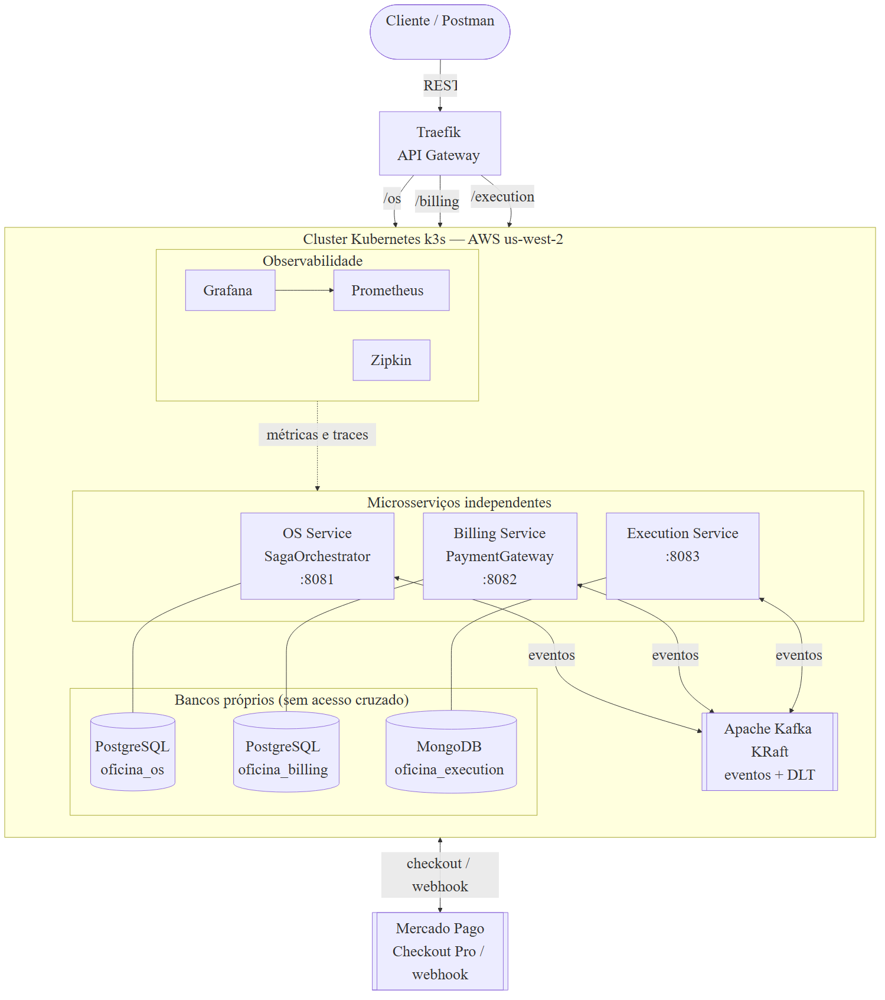

# Relatório — Tech Challenge Fase 4

## Identificação

| Campo | Valor |
|---|---|
| Grupo | Commit Sem Volta |
| Participante | Marcos da Paz Araujo |
| RM | RM370971 |
| Discord | `_marcosaraujo` |

## 1. Repositórios e vídeo

| Item | Link |
|---|---|
| OS Service | <https://github.com/rtmaraujo/tc-oficina-os-service> |
| Billing Service | <https://github.com/rtmaraujo/tc-oficina-billing-service> |
| Execution Service | <https://github.com/rtmaraujo/tc-oficina-execution-service> |
| Documentação | <https://github.com/rtmaraujo/tc-oficina-docs> |
| Vídeo de demonstração | <https://youtu.be/Cp_my8VnOtY> |

Cada serviço carrega a própria infraestrutura: `k8s/` (namespace, deployment, service, IngressRoute, configmap e secret), `Dockerfile`, pipeline e banco. O Execution versiona também o StatefulSet do MongoDB em `k8s/mongodb.yaml`.

**Resumo técnico.** Três serviços em Java 17 com Spring Boot 3.2, integrados por REST e Kafka. PostgreSQL 15 no OS e no Billing, MongoDB 7 no Execution. Pagamento pelo Mercado Pago Checkout Pro. 200 testes, cobertura acima de 90% em linha e SonarCloud com Quality Gate. Deploy em k3s na AWS, com Prometheus, Grafana e Zipkin. O quadro completo está na seção 5.

<div class="page-break"></div>

## 2. Arquitetura geral



- **REST:** o cliente entra pelo Traefik, que separa `/os`, `/billing` e `/execution`.
- **Kafka:** os serviços trocam eventos por tópicos, cada tópico com consumidor tem o seu `.DLT`.
- **Bancos:** cada serviço acessa só o próprio banco. A integração é por API ou evento.
- **Pagamento:** o Billing chama o Mercado Pago (Checkout Pro) e recebe o retorno no webhook.

### 2.1 Serviços

| Serviço | Responsabilidade | Banco | Porta |
|---|---|---|---|
| **OS Service** | Abre a OS, controla o status, guarda o histórico e executa a saga | PostgreSQL `oficina_os` | 8081 |
| **Billing Service** | Gera orçamento, registra aprovação e pagamento | PostgreSQL `oficina_billing` | 8082 |
| **Execution Service** | Fila de execução, diagnóstico, peças e entrega | MongoDB `oficina_execution` | 8083 |

### 2.2 Camadas internas

Os três serviços usam o mesmo desenho:

```
presentation (controllers, DTOs)
      |
application (services, saga, ports)
      |
domain (entidades e regras)
      ^
infrastructure (JPA/Mongo, adapters)
      |
config (Kafka, error handler, OpenAPI)
```

Controller não conhece persistência e integração externa fica atrás de porta (`PaymentGateway`). Isso permite trocar o mock do Mercado Pago por configuração, sem mexer na regra de negócio.

## 3. Saga Pattern

### 3.1 Estratégia escolhida: orquestração

Usei saga **orquestrada**. O OS Service é o orquestrador: guarda o estado da ordem de serviço, decide o próximo passo e publica o comando. Billing e Execution executam o passo e respondem por evento.

A escolha foi por orquestração porque o fluxo da OS tem ordem fixa e precisa de um ponto único para dizer em que passo está e o que desfazer. Na coreografia, os três serviços precisariam conhecer o fluxo inteiro, o que complica a compensação e a auditoria.

Fluxo: abertura da OS → orçamento gerado → aprovação → pagamento confirmado → execução → finalização.

### 3.2 Modelo de dados da Saga (OS Service)

| Tabela | Conteúdo |
|---|---|
| `saga_instancia` | `saga_id`, `os_id`, `status`, `passo_atual`, motivo |
| `saga_passo` | Trilha de passos, com status e detalhe |
| `ordem_servico_historico` | Transições de status, com `saga_id` e motivo |
| `evento_processado` | Idempotência por `event_id` + tópico |

A saga nasce como `EM_ANDAMENTO` e termina em `CONCLUIDA` ou `COMPENSADA`. Os passos gravados são `OS_CRIADA`, `ORCAMENTO_GERADO`, `ORCAMENTO_APROVADO`, `PAGAMENTO_CONFIRMADO`, `EXECUCAO_INICIADA`, `EXECUCAO_FINALIZADA` e `COMPENSACAO`.

### 3.3 Fluxo feliz

1. `POST /os/api/os` cria a OS em `ABERTA` e publica `os-created`.
2. O Billing gera o orçamento e publica `budget-generated`; a OS vai para `ORCAMENTO_GERADO`.
3. O cliente aprova; o Billing publica `budget-approved` e a OS vai para `APROVADA`.
4. O checkout cria a preferência no Mercado Pago; com o pagamento confirmado, a OS vai para `PAGA`.
5. A OS publica `execution-requested`; o Execution inicia e devolve `order-progress`, levando a OS para `EXECUCAO`.
6. O Execution finaliza e publica `order-finalized`: a OS vai para `CONCLUIDA` e a saga para `CONCLUIDA`.
7. A finalização manual (`PUT /os/api/os/{id}/status?novoStatus=FINALIZADA`) encerra a OS.

### 3.4 Compensação e rollback

A compensação roda em quatro casos: orçamento rejeitado, pagamento recusado, 30 minutos sem evolução (scheduler) e cancelamento manual. O OS Service então:

1. grava o histórico com o motivo;
2. muda a OS para `CANCELADA`;
3. fecha a saga como `COMPENSADA` e grava o passo `COMPENSACAO`;
4. publica `compensate-budget`, `compensate-execution` e `saga-compensated`.

O Billing cancela o orçamento e o Execution cancela a execução, se existir. A operação é idempotente: se a saga já está `COMPENSADA`, nada é republicado. Como o domínio não tem serviço de estoque, a compensação cobre só orçamento, pagamento e execução.

### 3.5 Idempotência e DLQ

- Cada evento leva um `eventId` (UUID) no envelope `SagaEvent`, junto com `sagaId`, `osId`, `osNumero`, `valor`, `status` e `paymentId`.
- A tabela `evento_processado` descarta reentregas nos três serviços.
- Falha de consumo passa pelo `DefaultErrorHandler` com backoff e vai para `<topico>.DLT`.

## 4. Justificativa da divisão e das tecnologias

### 4.1 Por que três microsserviços

| Serviço | Por que está separado |
|---|---|
| **OS Service** | É o dono do ciclo de vida da ordem e do estado da saga; precisa de consistência forte e histórico de cada transição |
| **Billing Service** | Isola o Mercado Pago e os dados financeiros; o provider pode mudar sem afetar a OS |
| **Execution Service** | Operação longa, com dados de formato variável; escala em ritmo diferente do fluxo financeiro |

A divisão segue os três contextos pedidos no enunciado. Trocar o provider de pagamento mexe só no Billing, e uma falha no Execution não impede abrir OS, gerar orçamento ou pagar.

### 4.2 Por que SQL e NoSQL

- **PostgreSQL 15** no OS e no Billing: os dois precisam de transação, constraint de status, histórico e registro financeiro. São duas bases separadas, cada uma acessível só pelo seu serviço.
- **MongoDB 7** no Execution: o documento de execução muda de formato com frequência (peças, etapas, laudo).

Não existe acesso cruzado a banco. A integração é sempre por REST ou evento.

### 4.3 Por que REST e Kafka

| Estilo | Onde aparece |
|---|---|
| **REST** | Comando e consulta com resposta imediata: abrir OS, consultar status, aprovar orçamento, criar checkout |
| **Kafka** | Fluxo longo e desacoplamento: `os-created`, `budget-generated`, `payment-completed`, `execution-requested`, `order-finalized`, compensações |

REST resolve o que precisa de resposta na hora. Kafka evita acoplamento temporal nos processos longos, e a confiabilidade fica com idempotência e DLT.

## 5. Quadro resumo técnico

| Item | O que foi usado |
|---|---|
| Linguagem | Java 17 com Spring Boot 3.2 |
| Banco SQL | PostgreSQL 15 no RDS, em duas bases: `oficina_os` e `oficina_billing` |
| Banco NoSQL | MongoDB 7, base `oficina_execution` |
| Mensageria | Apache Kafka (KRaft) com um `.DLT` por tópico de consumo |
| Pagamento | Mercado Pago Checkout Pro e webhook com validação HMAC-SHA256 |
| BDD e cobertura | Cucumber no OS Service; 200 testes (66 + 90 + 44); cobertura de linha de 100%, 99,07% e 98,63% |
| Qualidade | SonarCloud no pipeline, com Quality Gate obrigatório |
| Infraestrutura | Kubernetes k3s em EC2, Traefik, Amazon ECR e RDS, Terraform |
| Observabilidade | Micrometer, Prometheus, Grafana e Zipkin |

## 6. APIs e eventos

### 6.1 APIs publicadas

#### OS Service — `/os`

| Método | Rota |
|---|---|
| `POST` | `/api/os?clienteCpf=&descricao=` |
| `GET` | `/api/os/{id}` |
| `GET` | `/api/os/cliente/{clienteCpf}` |
| `GET` | `/api/os/{id}/historico` |
| `PUT` | `/api/os/{id}/status?novoStatus=` |

#### Billing Service — `/billing`

| Método | Rota |
|---|---|
| `POST` | `/api/billing/orcamento?clienteCpf=&valor=` |
| `GET` | `/api/billing/orcamento/{id}` |
| `GET` | `/api/billing/cliente/{clienteCpf}` |
| `PUT` | `/api/billing/orcamento/{id}/status?novoStatus=` |
| `POST` | `/api/billing/orcamento/{id}/checkout` |
| `POST` | `/api/billing/orcamento/{id}/simular-pagamento?aprovado=` |
| `POST` | `/webhook/mercadopago` |

#### Execution Service — `/execution`

| Método | Rota |
|---|---|
| `POST` | `/api/execution/iniciar/{osNumero}` |
| `GET` | `/api/execution/status/{statusExecucao}` |
| `POST` | `/api/execution/{id}/pecas?pecas=` |
| `POST` | `/api/execution/{id}/finalizar` |
| `GET` | `/api/execution/{id}` |

### 6.2 Swagger e Postman

- Swagger UI em `/{servico}/swagger-ui/index.html`.
- Coleção `postman/Tech-Challenge-Fase4.postman_collection.json` com o environment correspondente.

### 6.3 Eventos

| Tópico | Produtor → Consumidor |
|---|---|
| `os-created` | OS → Billing |
| `budget-generated` | Billing → OS |
| `budget-approved` | Billing → OS |
| `budget-rejected` | Billing → OS (compensação) |
| `payment-completed` | Billing → OS |
| `payment-failed` | Billing → OS (compensação) |
| `execution-requested` | OS → Execution |
| `order-progress` | Execution → OS |
| `order-finalized` | Execution → OS |
| `compensate-budget` | OS → Billing |
| `compensate-execution` | OS → Execution |
| `execution-compensated` | Execution → OS |
| `saga-compensated` | OS → auditoria |

## 7. Qualidade e testes

### 7.1 Testes unitários e BDD

JUnit 5 + Mockito nos três serviços. O OS Service roda também o BDD com Cucumber:

- **OS aprovada, paga, executada e finalizada** → status final `FINALIZADA`, com `os-created` e `execution-requested` publicados.
- **Compensação por orçamento rejeitado** → status `CANCELADA`, com `compensate-budget`, `compensate-execution` e `saga-compensated` publicados.

Cenário em `src/test/resources/features/ordem-servico-saga.feature`.

### 7.2 Cobertura

| Serviço | Testes | Falhas | Linha | Branch |
|---|---|---|---|---|
| OS | 66 | 0 | 100,00% | 96,36% |
| Billing | 90 | 0 | 99,07% | 91,67% |
| Execution | 44 | 0 | 98,63% | 90,38% |
| **Total** | **200** | **0** | — | — |

O `mvn verify` roda `jacoco:check` com mínimo de 85% em linha e branch, acima dos 80% exigidos.

### 7.3 Análise estática (SonarCloud)

O SonarCloud roda no pipeline com `-Dsonar.qualitygate.wait=true` e os três projetos estão com Quality Gate aprovado. Os links estão na página 1.

Achados corrigidos: secrets dentro de `run:` movidos para `env:` (S7636), log injection no webhook (S5145), injeção por campo trocada por construtor nos controllers (S6813) e remoção das exclusões de `config`/`presentation` que escondiam código novo.

## 8. CI/CD e proteção da main

Cada repositório tem seu `.github/workflows/ci.yml`:

1. Checkout, JDK 17 e cache Maven.
2. `mvn verify` com build, testes e JaCoCo.
3. SonarCloud com Quality Gate obrigatório.
4. Na `main`: push da imagem com a tag do commit no ECR e `kubectl set image` + `rollout status` no k3s.

A `main` exige PR e o check **Build, testes, cobertura e SonarCloud** aprovado. As entregas entraram por PR, com squash merge.

| Serviço | Run do merge | Réplicas | Imagem em produção |
|---|---|---|---|
| OS | success | 2/2 | `66e8d36…` |
| Billing | success | 2/2 | `16f2f9d…` |
| Execution | success | 2/2 | `ffb15ca…` |

## 9. Observabilidade

| Pilar | Ferramenta | Onde |
|---|---|---|
| Métricas | Prometheus | `/prometheus/graph` — 3 targets `up` |
| Dashboards | Grafana | `/grafana/` — dashboard *Oficina Fase 4 - Microsservicos* |
| Traces | Zipkin | `/zipkin/` — traces dos três serviços |
| Saúde | Actuator | `/{servico}/actuator/health` — todos `200` |

O `sagaId` vai no MDC dos logs e nos traces, o que permite seguir uma OS pelos três serviços.

## 10. Infraestrutura

### 10.1 Recursos provisionados

| Recurso | Detalhe |
|---|---|
| Cluster | k3s em EC2, não EKS (1 server + 2 workers `t3.small`), VPC `10.0.0.0/16` |
| Entrada | Traefik com `IngressRoute` e `stripPrefix` para `/os`, `/billing`, `/execution` e `/webhook` |
| Mensageria | Kafka KRaft no namespace `oficina-infra`, tópicos e DLT criados por Job |
| Bancos | 2 instâncias RDS PostgreSQL + MongoDB StatefulSet |
| Observabilidade | namespace `monitoring` com Prometheus, Grafana e Zipkin |
| IaC | Terraform para ECR e RDS; VPC, EC2 e EIP criados no console |

### 10.2 Onde está versionado

| Escopo | Onde está |
|---|---|
| Manifestos | `k8s/` de cada serviço, com deployment (2 réplicas), service, `IngressRoute`, configmap e secret, além do `Dockerfile` e do pipeline |
| Banco | Um por serviço: `oficina_os` e `oficina_billing` no RDS, MongoDB do Execution em StatefulSet |
| Compartilhado | Terraform de ECR/RDS, Kafka e monitoring ficam no ambiente do projeto |

## 11. Conclusão

A Fase 4 saiu do monolito para três serviços independentes, cada um com repositório, banco, pipeline e deploy próprios, integrados por REST e Kafka.

A consistência do processo distribuído fica com uma saga orquestrada no OS Service: estado registrado passo a passo, compensação nos quatro casos de falha, idempotência por `eventId` e DLT por tópico de consumo. São 200 testes, BDD do fluxo completo, cobertura acima de 80% em todos os serviços e Quality Gate aprovado, com o fluxo feliz e as duas compensações executados no ambiente publicado.
