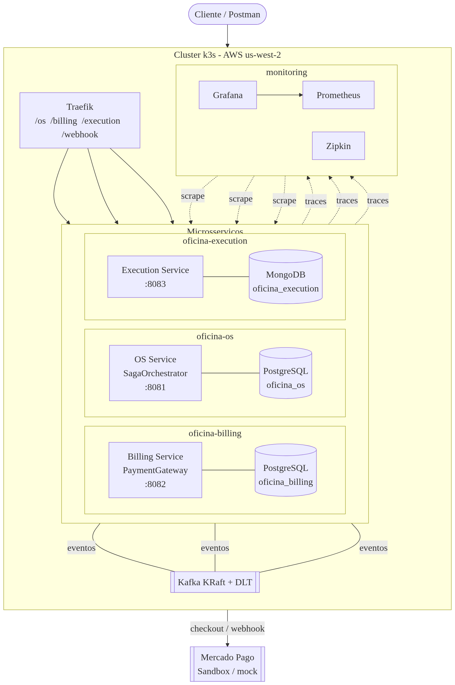

# Relatório de Entrega — Tech Challenge Fase 4

| Item | Valor |
|---|---|
| Participante | **Marcos da Paz Araujo** |
| Repositórios | `tc-oficina-os-service`, `tc-oficina-billing-service`, `tc-oficina-execution-service` |
| Organização SonarCloud | `rtmaraujo` |
| Ambiente publicado | `http://44.253.115.185` |
| Data da entrega | 05/11/2026 |

## 1. Links da entrega

| Item | Link |
|---|---|
| Repositório — OS Service | https://github.com/rtmaraujo/tc-oficina-os-service |
| Repositório — Billing Service | https://github.com/rtmaraujo/tc-oficina-billing-service |
| Repositório — Execution Service | https://github.com/rtmaraujo/tc-oficina-execution-service |
| SonarCloud — OS | https://sonarcloud.io/project/overview?id=rtmaraujo_tc-oficina-os-service |
| SonarCloud — Billing | https://sonarcloud.io/project/overview?id=rtmaraujo_tc-oficina-billing-service |
| SonarCloud — Execution | https://sonarcloud.io/project/overview?id=rtmaraujo_tc-oficina-execution-service |
| Ambiente publicado | http://44.253.115.185 |
| Vídeo de demonstração | https://youtu.be/Cp_my8VnOtY |

---

## 2. Resumo executivo

A Fase 4 evoluiu o sistema monolítico das fases anteriores para **três microsserviços independentes**, cada um com repositório, banco, pipeline e ciclo de deploy próprios, integrados de forma **assíncrona por Apache Kafka**.

O núcleo da solução é uma **Saga orquestrada** no OS Service, que mantém a máquina de estados da ordem de serviço, registra cada passo (`saga_instancia` / `saga_passo`), garante **idempotência** por `eventId` e executa **compensações** quando o orçamento é rejeitado, o pagamento é recusado ou a execução falha.

Entregas concluídas:

- 3 serviços publicados no k3s com **2 réplicas cada**, imagens versionadas no Amazon ECR.
- Saga validada ponta a ponta: **fluxo feliz + 2 cenários de compensação**.
- **200 testes automatizados** (66 + 90 + 44), todos verdes, com JaCoCo acima do mínimo de 85%.
- **SonarCloud** com Quality Gate aprovado nos três projetos.
- **Prometheus + Grafana + Zipkin** funcionando, com dashboard provisionado e traces dos três serviços.
- Pipelines GitHub Actions com build, testes, cobertura, análise e deploy — `main` protegida por PR.

---

## 3. Arquitetura da solução

A arquitetura completa, com diagramas Mermaid da Saga, máquina de estados e catálogo de eventos, está em [`ARQUITETURA.md`](./ARQUITETURA.md).

### 3.1 Serviços

| Serviço | Responsabilidade | Banco | Porta | Namespace |
|---|---|---|---|---|
| **OS Service** | Ordem de serviço, máquina de estados, **orquestração da Saga**, histórico, idempotência | PostgreSQL `oficina_os` (RDS) | 8081 | `oficina-os` |
| **Billing Service** | Orçamento, aprovação, pagamento (porta `PaymentGateway`), compensação | PostgreSQL `oficina_billing` (RDS) | 8082 | `oficina-billing` |
| **Execution Service** | Diagnóstico, peças, execução, entrega | MongoDB `oficina_execution` (StatefulSet) | 8083 | `oficina-execution` |

Cada serviço segue o mesmo desenho em camadas (`presentation → application → domain ← infrastructure` + `config`), com controllers por injeção de construtor e integrações externas atrás de portas.

### 3.2 Diagrama geral da arquitetura



> Diagrama editável em `diagrams/diagrama-arquitetura.mmd` (Mermaid). O fluxo detalhado da Saga está na seção 4.

### 3.3 Infraestrutura

| Recurso | Detalhe |
|---|---|
| Cluster | k3s — 1 server + 2 workers `t3.small` (VPC `10.0.0.0/16`) |
| Entrada | Traefik com `IngressRoute` + `stripPrefix` para `/os`, `/billing`, `/execution`, `/webhook` |
| Mensageria | Kafka KRaft no namespace `oficina-infra`, tópicos + `.DLT` criados por Job |
| Bancos | 2 instâncias RDS PostgreSQL + MongoDB StatefulSet |
| Imagens | Amazon ECR `us-west-2` (conta `200111905660`) |
| Observabilidade | namespace `monitoring` — Prometheus, Grafana, Zipkin |

---

## 4. Saga orquestrada

### 4.1 Modelo

O OS Service é o **orquestrador**: decide os próximos passos e publica comandos. Billing e Execution são **participantes** e publicam eventos de resultado. O `sagaId` (`SAGA-<numeroOS>`) identifica toda a execução e é propagado no MDC, nos logs e nos traces.

| Tabela | Conteúdo |
|---|---|
| `saga_instancia` | `saga_id`, `os_id`, `os_numero`, `status` (`EM_ANDAMENTO`/`CONCLUIDA`/`COMPENSADA`), `passo_atual`, `motivo` |
| `saga_passo` | Trilha de passos com status e detalhe |
| `ordem_servico_historico` | Transições de status com `saga_id` e motivo |
| `evento_processado` | Idempotência (`event_id` + tópico) |

### 4.2 Fluxo feliz

```
ABERTA → ORCAMENTO_GERADO → APROVADA → PAGA → EXECUCAO → CONCLUIDA → FINALIZADA
```

1. `POST /os/api/os` cria a OS (`ABERTA`) e publica `os-created`.
2. Billing consome, gera orçamento (`PENDENTE`) e publica `budget-generated`.
3. OS recebe e marca `ORCAMENTO_GERADO` com o valor.
4. Cliente aprova (`PUT /billing/.../status?novoStatus=APROVADO`) → `budget-approved` → OS `APROVADA`.
5. Checkout cria a preferência no Mercado Pago e o pagamento é confirmado → `payment-completed` → OS `PAGA`.
6. OS publica `execution-requested`; Execution cria a execução e publica `order-progress` → OS `EXECUCAO`.
7. Execution finaliza e publica `order-finalized` → OS `CONCLUIDA` e saga `CONCLUIDA`.
8. Encerramento manual: `PUT /os/api/os/{id}/status?novoStatus=FINALIZADA`.

### 4.3 Compensação

Disparada por `budget-rejected`, `payment-failed`, **timeout** (30 min sem evolução, via `SagaTimeoutScheduler`) ou **cancelamento manual**. O orquestrador:

1. registra o histórico com o motivo;
2. muda a OS para `CANCELADA`;
3. marca a saga `COMPENSADA`, grava o passo `COMPENSACAO`;
4. publica `compensate-budget`, `compensate-execution` e `saga-compensated`.

A operação é **idempotente**: se a saga já está `COMPENSADA`, nada é republicado.

### 4.4 Idempotência e DLQ

- Envelope JSON (`SagaEvent`) com `eventId` (UUID), `type`, `sagaId`, `osId`, `osNumero`, `clienteCpf`, `valor`, `status`, `paymentId`, `codigoOrcamento`, `message`, `timestamp`.
- `evento_processado` descarta reentregas nos três serviços.
- `DefaultErrorHandler` com backoff e publicação em `<topico>.DLT` após esgotar tentativas.

---

## 5. Catálogo de eventos

| Tópico | Produtor | Consumidor | Papel |
|---|---|---|---|
| `os-created` | OS | Billing | Solicita orçamento |
| `budget-generated` | Billing | OS | Orçamento criado |
| `budget-approved` | Billing | OS | Orçamento aprovado |
| `budget-rejected` | Billing | OS | Rejeição → compensação |
| `payment-completed` | Billing | OS | Pagamento confirmado |
| `payment-failed` | Billing | OS | Pagamento recusado → compensação |
| `execution-requested` | OS | Execution | Inicia execução |
| `order-progress` | Execution | OS | Execução em andamento |
| `order-finalized` | Execution | OS | Execução finalizada |
| `compensate-budget` | OS | Billing | Compensa orçamento |
| `compensate-execution` | OS | Execution | Compensa execução |
| `saga-compensated` | OS | — | Auditoria da compensação |
| `execution-compensated` | Execution | OS | Confirmação da compensação |

Todos com `.DLT` correspondente. Grupos: `os-service-group`, `billing-service-group`, `execution-service-group`.

---

## 6. APIs publicadas

### OS Service — `http://44.253.115.185/os`
| Método | Rota |
|---|---|
| `POST` | `/api/os?clienteCpf=&descricao=` |
| `GET` | `/api/os/{id}` |
| `GET` | `/api/os/cliente/{clienteCpf}` |
| `GET` | `/api/os/{id}/historico` |
| `PUT` | `/api/os/{id}/status?novoStatus=` |

### Billing Service — `http://44.253.115.185/billing`
| Método | Rota |
|---|---|
| `POST` | `/api/billing/orcamento?clienteCpf=&valor=` |
| `GET` | `/api/billing/orcamento/{id}` |
| `GET` | `/api/billing/cliente/{clienteCpf}` |
| `PUT` | `/api/billing/orcamento/{id}/status?novoStatus=` |
| `POST` | `/api/billing/orcamento/{id}/checkout` |
| `POST` | `/api/billing/orcamento/{id}/simular-pagamento?aprovado=` |
| `POST` | `/webhook/mercadopago` (fora do prefixo `/billing`) |

### Execution Service — `http://44.253.115.185/execution`
| Método | Rota |
|---|---|
| `POST` | `/api/execution/iniciar/{osNumero}` |
| `GET` | `/api/execution/status/{statusExecucao}` |
| `POST` | `/api/execution/{id}/pecas?pecas=` |
| `POST` | `/api/execution/{id}/finalizar` |
| `GET` | `/api/execution/{id}` |

Swagger UI: `/os/swagger-ui/index.html`, `/billing/swagger-ui/index.html`, `/execution/swagger-ui/index.html`.
Coleção Postman: `postman/Tech-Challenge-Fase4.postman_collection.json` + environment `postman/Tech-Challenge-Fase4.postman_environment.json`.

---

## 7. Qualidade e testes

### 7.1 Suíte automatizada

| Serviço | Testes | Falhas | Cobertura de linha | Cobertura de branch |
|---|---|---|---|---|
| OS | 66 | 0 | **100,00%** | **96,36%** |
| Billing | 90 | 0 | **99,07%** | **91,67%** |
| Execution | 44 | 0 | **98,63%** | **90,38%** |
| **Total** | **200** | **0** | — | — |

- JaCoCo com `check` obrigatório em **85% de LINE e BRANCH** no `mvn verify`.
- Testes incluem BDD (Cucumber) no OS Service cobrindo o fluxo da Saga e cancelamento.
- SonarCloud: Quality Gate aprovado nos três projetos, com foco em cobertura de **código novo**.

### 7.2 Correções de qualidade aplicadas

| Regra | Problema | Correção |
|---|---|---|
| S7636 | Secrets interpolados dentro de `run:` no workflow | Movidos para `env:` |
| S5145 | Log injection no webhook | Passou a registrar apenas o tamanho do corpo |
| S6813 | Injeção por campo nos controllers | Migrado para injeção por construtor |
| Cobertura de código novo | Exclusões de `config`/`presentation` escondiam código novo | Exclusões removidas nos três `pom.xml` |

Links: [OS](https://sonarcloud.io/project/overview?id=rtmaraujo_tc-oficina-os-service) · [Billing](https://sonarcloud.io/project/overview?id=rtmaraujo_tc-oficina-billing-service) · [Execution](https://sonarcloud.io/project/overview?id=rtmaraujo_tc-oficina-execution-service)

---

## 8. CI/CD e proteção da `main`

Cada repositório tem `.github/workflows/ci.yml` com:

1. Checkout + JDK 17 + cache Maven.
2. Build e testes com JaCoCo (`mvn verify`).
3. Análise SonarCloud com `-Dsonar.qualitygate.wait=true`.
4. Em push na `main`: build/push da imagem com a tag do commit no ECR e deploy no k3s (`kubectl set image` + `rollout status`).

A `main` exige PR e o check **Build, testes, cobertura e SonarCloud** aprovado. As entregas de código entraram por PR (#7 no OS, #7 no Billing, #6 no Execution) e as atualizações de documentação por PR (#8 no OS, #8 no Billing, #7 no Execution), todas com checks verdes e squash merge.

| Serviço | Run do merge | Réplicas | Imagem em produção |
|---|---|---|---|
| OS | success | 2/2 | `66e8d36…` |
| Billing | success | 2/2 | `16f2f9d…` |
| Execution | success | 2/2 | `ffb15ca…` |

---

## 9. Observabilidade

| Pilar | Ferramenta | URL | Situação |
|---|---|---|---|
| Métricas | Prometheus | `http://44.253.115.185/prometheus/graph` | 3 targets `up` |
| Dashboards | Grafana | `http://44.253.115.185/grafana/` | dashboard **Oficina Fase 4 - Microsservicos** provisionado |
| Traces | Zipkin | `http://44.253.115.185/zipkin/` | traces dos 3 serviços |
| Saúde | Actuator | `/{servico}/actuator/health` | todos `200` |

Evidências coletadas:

- `GET /prometheus/api/v1/targets` → `os-service`, `billing-service`, `execution-service` com `health=up`.
- `GET /zipkin/api/v2/services` → `["tc-oficina-billing-service","tc-oficina-execution-service","tc-oficina-os-service"]`.
- Dashboard com painéis de requisições/s, p95, erros 5xx e heap JVM, agrupados pelo label `job`.
- O `sagaId` aparece no MDC dos logs, permitindo correlacionar uma OS entre os três serviços.

---

## 10. Evidências dos fluxos executados

Ambiente: `http://44.253.115.185`. Evidências de orquestração coletadas em 03/11/2026; o provider real do Mercado Pago está ativo no cluster — ver seção 12.

### 10.1 Fluxo feliz — OS 9 (`OS-1793737175866`)

| De | Para | Motivo |
|---|---|---|
| — | `ABERTA` | Ordem de serviço criada |
| `ABERTA` | `ORCAMENTO_GERADO` | Orçamento `ORC-1793737181104` gerado |
| `ORCAMENTO_GERADO` | `APROVADA` | Orçamento aprovado pelo cliente |
| `APROVADA` | `PAGA` | Pagamento confirmado (`payment-completed`) |
| `PAGA` | `EXECUCAO` | Execução iniciada: DIAGNOSTICO |
| `EXECUCAO` | `CONCLUIDA` | Execução finalizada pelo Execution Service |
| `CONCLUIDA` | `FINALIZADA` | Finalização manual da OS |

Saga `SAGA-OS-1793737175866` → `CONCLUIDA`, passo `EXECUCAO_FINALIZADA`.

### 10.2 Compensação por orçamento rejeitado — OS 10

| De | Para | Motivo |
|---|---|---|
| — | `ABERTA` | Ordem de serviço criada |
| `ABERTA` | `ORCAMENTO_GERADO` | Orçamento `ORC-1793737198727` gerado |
| `ORCAMENTO_GERADO` | `CANCELADA` | Orçamento rejeitado pelo cliente |

Saga `SAGA-OS-1793737196370` → `COMPENSADA`; orçamento → `CANCELADO`.

### 10.3 Compensação por pagamento recusado — OS 11

| De | Para | Motivo |
|---|---|---|
| — | `ABERTA` | Ordem de serviço criada |
| `ABERTA` | `ORCAMENTO_GERADO` | Orçamento `ORC-1793737204667` gerado |
| `ORCAMENTO_GERADO` | `APROVADA` | Orçamento aprovado pelo cliente |
| `APROVADA` | `CANCELADA` | Pagamento recusado: `PAYMENT_FAILED` |

Saga `SAGA-OS-1793737204636` → `COMPENSADA`; orçamento → `CANCELADO`.

### 10.4 Consulta de evidência no banco

Job de evidência (namespace `oficina-os`), saída completa em [`evidencias/saga-evidence-2026-11-03.txt`](evidencias/saga-evidence-2026-11-03.txt):

- 10 sagas registradas em `saga_instancia` (4 `CONCLUIDA` e 6 `COMPENSADA`).
- 44 passos registrados em `saga_passo`.
- `evento_processado` com eventos dos 7 tópicos consumidos (`budget-approved`, `budget-generated`, `budget-rejected`, `order-finalized`, `order-progress`, `payment-completed`, `payment-failed`).

---

## 11. Dificuldades encontradas e soluções

| # | Dificuldade | Diagnóstico | Solução |
|---|---|---|---|
| 1 | Deploy falhava quando os 3 pipelines rodavam juntos | Concorrência de pull de imagens + memória do cluster (3 × 2 GB) | Deploys reexecutados **um por vez** |
| 2 | Zipkin em `CrashLoopBackOff` | `OOMKilled` (limite de 192Mi) | Limite elevado para 512Mi e `ZIPKIN_UI_BASEPATH` corrigido |
| 3 | `/prometheus` retornava 404 | Faltava `IngressRoute` + `stripPrefix` | Middleware `strip-prometheus-prefix` adicionado |
| 4 | Painéis do Grafana vazios | Queries agrupavam por `application`, label inexistente | Reescritas para `job` |
| 5 | **OS travava em `APROVADA` após o pagamento** | `CHECK constraint ordem_servico_status_check` sem `PAGA` → rollback + retry infinito do `payment-completed` | Constraint recriada via Job aplicado no cluster; billing validado no mesmo formato |
| 6 | Filtro de orçamento no PowerShell retornava array | Endpoint por cliente devolve vários registros | Filtro por `sagaId`/`osId` na automação |
| 7 | `kubectl apply` com timeout e SSH `Broken pipe` | Pressão de memória do nó | Aplicação serializada + `Start-Sleep` entre etapas |

O item 5 é o achado mais relevante: um **bug real de integração** que só apareceu no fluxo ponta a ponta, com a saga aparentando sucesso e a OS presa em `APROVADA`. Foi diagnosticado pelos logs (`violates check constraint`) e corrigido no banco, mantendo o histórico de migração junto à infraestrutura (fora deste repositório de documentação).

---

## 12. Limitações e trabalhos futuros

1. **Mercado Pago real**: implementado (`MercadoPagoPaymentGateway`) — preferência no Checkout Pro, consulta de pagamento, validação de assinatura HMAC-SHA256 e tratamento de estados intermediários. Ativo no cluster com `PAGAMENTO_PROVIDER=mercadopago` e credenciais de sandbox no secret `billing-service-secret`. O `MockPaymentGateway` é mantido para demonstração local.
2. **Transactional Outbox**: a publicação ocorre dentro da transação; não há tabela de outbox dedicada (mitigado por idempotência e DLT).
3. **Testes de integração** com Testcontainers não fazem parte do escopo desta fase.
4. **Credenciais AWS Academy** expiram em poucas horas, exigindo renovação antes de novos deploys.
5. **Segredos**: os manifestos versionados não contêm credenciais; em produção evoluir para Sealed Secrets/External Secrets.

---

## 13. Conclusão

A Fase 4 entrega os três microsserviços independentes, a Saga orquestrada com compensação e auditoria, idempotência, DLQ, pipelines com Quality Gate, observabilidade completa e evidências reais dos fluxos feliz e de compensação. O sistema está publicado e operante em `http://44.253.115.185`, com 200 testes verdes e cobertura acima do exigido.

---

## Anexos

- [`ARQUITETURA.md`](./ARQUITETURA.md) — diagramas e decisões técnicas
- [`Vídeo de demonstração`](https://youtu.be/Cp_my8VnOtY) — overview da aplicação
- `postman/Tech-Challenge-Fase4.postman_collection.json` — coleção executável
- Manifests de infraestrutura (Kafka, monitoring, SQL e Terraform) — mantidos no ambiente de execução; não versionados neste repositório
